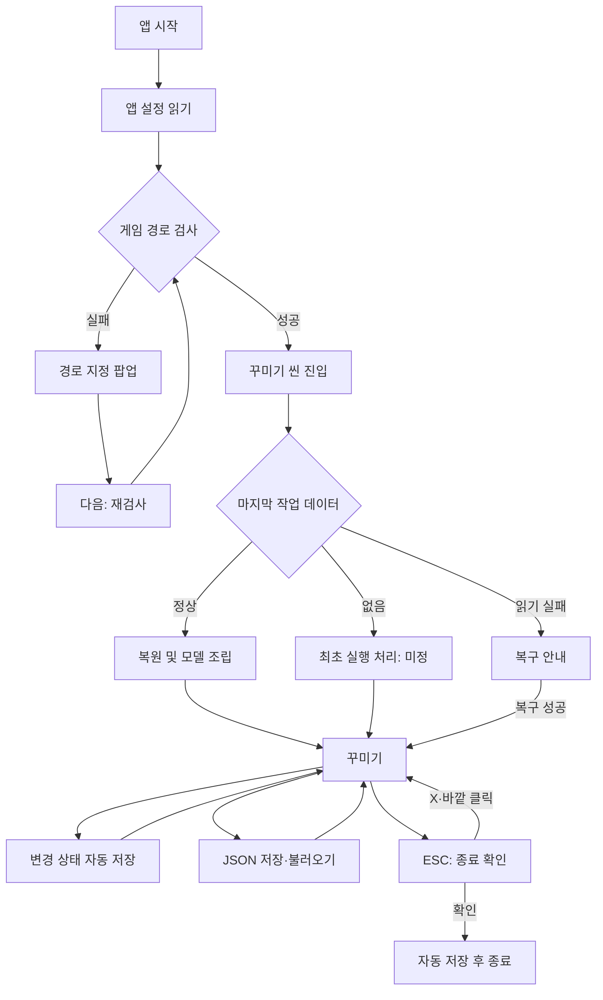

# MobiAtelier 프로그램 흐름 및 화면 기획

> 작성일: 2026-11-01
> 대상: Unity 기반 Windows 빌드.
> 목적: 사용자 PC에 설치된 마비노기 모바일 리소스를 읽어 외형·의상·염색을 미리 확인한다.
> 상태: 사용자 확정 요구사항을 중심으로 정리한 기획 초안. 세부 제안과 미정 사항은 별도 표시한다.

## 1. 요구사항 우선순위

이 문서의 사용자 확정 사항은 ReferenceResearch.md의 이전 제안보다 우선한다. 특히 이전의 좌·중·우 3분할 배치는 고정 요구가 아니며, 이번에는 모델과 카메라 위에 **크기 조절 가능한 꾸미기 창 하나**를 기본으로 한다.

| 구분 | 내용 |
|---|---|
| 확정 | Windows 빌드, 기본 게임 경로 C:\Nexon\MabinogiMobile |
| 확정 | 시작 시 경로 검사, 실패하면 경로 지정 팝업 |
| 확정 | 경로 직접 입력과 Windows 폴더 선택창 지원, 다음 버튼으로 검사 후 진행 |
| 확정 | 꾸미기 씬에서 마지막 편집 상태 복원 |
| 확정 | 현재 편집 상태는 Application.persistentDataPath에 저장 |
| 확정 | 사용자가 꾸미기 데이터를 JSON으로 저장하고 불러오기 |
| 확정 | 수동 저장 대화상자의 최초 기본 폴더는 프로그램 설치 폴더, 이후 다른 폴더에 저장하면 그 폴더 사용 |
| 확정 | 모델·카메라 및 크기 조절 가능한 꾸미기 창, 드롭다운·검색 중심 선택 |
| 확정 | 카메라 조작은 마비노기 모바일 PC 촬영모드를 기준으로 재현 |
| 확정 | 꾸미기 씬의 ESC는 종료 확인 팝업, 확인 시 종료, X·바깥 클릭 시 취소, 배경 딤 처리 |
| 미정 | 최초 실행에서 배치할 외형·의상 |
| 미정 | 향후 촬영모드의 기능과 화면 |
| 제안 | 마지막 정상 게임 경로 기억, 자동 저장 시점·오류 복구, 창 배치 기억, 키 입력 우선순위 등 아래 세부 규칙 |

사용자 미정 항목은 구현자가 임의로 제품 기본값으로 확정하지 않는다.

## 2. 전체 흐름

※ 다이어그램의 종료 취소 조건은 X 또는 팝업 바깥 클릭이다. 초기 실행·복구 경로의 세부 내용은 5장에 따른다.

## 3. 앱 시작과 게임 경로 검사

### 3.1 검사할 경로

- 최초 기본값: C:\Nexon\MabinogiMobile.
- **제안**: 마지막으로 검사를 통과한 경로를 앱 설정에 저장하고 다음 실행에서 먼저 검사한다. 저장된 경로가 없으면 최초 기본값을 쓴다.
- 검사 성공 없이 입력값만 바뀐 경우에는 마지막 정상 경로를 갱신하지 않는다.
- 원본 게임 파일은 읽기만 한다.

### 3.2 정상 구성의 의미

폴더 존재 여부나 실행 파일 하나의 존재만으로 통과시키지 않는다.

| 검사 단계 | 검사 내용 | 실패 시 동작 |
|---|---|---|
| 경로 | 폴더가 있고 접근 가능한가 | 경로 팝업과 이유 표시 |
| 필수 index | 조립기에 필요한 AssetPackages·ResourcesPackage의 루트·Starter index가 있는가 | 누락 파일 안내 |
| index 형식 | 헤더·레코드를 해석할 수 있는가 | 읽기 실패·지원 불가 안내 |
| 필수 데이터 | 시작에 필요한 정의·시트·리소스의 위치를 찾을 수 있는가 | 누락 데이터 안내 |
| 실제 읽기 | 필요한 blob의 범위를 정상적으로 읽을 수 있는가 | 재검사 안내 |

- 필수 파일 목록은 실제 로더가 사용하는 범위로 관리한다. 저장소 문서만으로 모든 버전의 파일 구성을 하드코딩하지 않는다.
- 최초에는 시작에 필요한 범위를 검사하고, 모든 의상 데이터를 전수 검사하지 않는다.
- 경로 검사 성공과 모든 의상 지원은 별개다. 개별 파츠 오류는 편집 중 별도로 처리한다.
- 런처 패치로 파일 구성이 바뀌었거나 잠시 읽을 수 없으면 실패 이유와 재시도 방법을 알려준다.
- 지원 게임 버전 판정 방식과 버전 표시 위치는 구현 시 구체화한다.

## 4. 경로 지정 팝업

### 4.1 구성

| 요소 | 내용 |
|---|---|
| 제목 | 마비노기 모바일 설치 경로 |
| 설명 | 설치 폴더를 찾지 못했거나 필요한 파일을 읽을 수 없음을 안내 |
| 경로 입력란 | 기본 경로 또는 마지막 입력 경로 |
| 폴더 선택 버튼 | Windows 기본 폴더 선택창 열기 |
| 검사 결과 | 입력란 아래에 누락·접근·형식 오류 표시 |
| 하단 버튼 | 다음 |

문구 예:
- 설치된 마비노기 모바일 폴더를 선택해 주세요.
- 이 폴더에서 필요한 파일을 찾지 못했습니다.
- 파일을 읽지 못했습니다. 게임 패치가 끝난 뒤 다시 시도해 주세요.

### 4.2 상호작용

1. 직접 입력 또는 폴더 선택으로 입력값을 바꾼다.
2. 폴더 선택을 취소하면 기존 입력값을 유지한다.
3. 다음을 누르면 경로 검사를 시작한다.
4. 검사 중 중복 다음 입력을 막고 검사 중 상태를 표시한다.
5. 실패하면 팝업을 유지하고 원인을 표시한다.
6. 성공하면 경로를 기억하고 팝업을 닫은 뒤 꾸미기 씬으로 진행한다.

**제안**
- 입력 앞뒤 공백과 경로를 감싼 따옴표는 정리한다. 경로 중간 공백은 보존한다.
- Enter는 경로 검사 실행으로 연결한다.
- 필수 경로가 정해지기 전에는 팝업 바깥 클릭이나 X로 검사를 우회해 꾸미기 씬에 들어갈 수 없게 한다.
- 시작 화면에서 종료할 수 있는 수단은 제공하되, 시작 화면 종료 UI의 모양은 후속 결정한다.

## 5. 꾸미기 씬 진입과 초기 상태

### 5.1 공통 로딩

- 필요한 index·시트·리소스 로딩 진행 상태를 표시한다.
- 현재 작업 데이터를 읽고, 해당 데이터의 파츠를 해석한 뒤 모델을 조립한다.
- 입력·로딩 실패 상태를 모델이 없는 빈 화면으로만 남겨두지 않는다.

### 5.2 마지막 작업이 있는 경우

- 마지막 정상 편집 상태의 외형·착용 파츠·염색값을 복원한다.
- **제안**: 카메라와 꾸미기 창 위치·크기도 함께 복원한다. 외형 데이터와 UI 설정은 저장 구조상 분리한다.
- 복원된 상태는 자동 복원 데이터다. 사용자가 마지막으로 수동 저장한 JSON을 자동으로 덮어쓰지 않는다.

### 5.3 최초 실행

배치할 초기 캐릭터는 **미정**이다.

| 후보 | 장점 | 검토할 점 |
|---|---|---|
| 기본 외형 프리셋 1개 | 바로 조작 가능 | 기본 성별·외형·옷을 정해야 함 |
| 간단한 시작 선택 | 사용자가 외형 기준을 선택 | 시작 단계가 늘어남 |
| 새로 만들기·JSON 불러오기 선택 | 기존 코디 파일로 곧바로 시작 가능 | 신규 사용자에게는 기본 외형이 여전히 필요 |

- 위 후보 중 하나를 아직 확정하지 않는다.
- 기술 테스트의 힐러 원피스 모델은 검증용 사례이며 제품 최초 기본값이 아니다.
- 개발 중 임시 프리셋이 필요하면 테스트용임을 구분하고 교체 가능하게 한다.

### 5.4 마지막 작업 복원 실패

**제안**
- JSON 손상·지원하지 않는 형식·찾을 수 없는 파츠를 구분한다.
- 손상된 자동 저장 파일을 빈 값이나 기본값으로 즉시 덮어쓰지 않는다.
- 백업 복구, 다른 JSON 불러오기, 새 작업 중 가능한 경로를 안내한다.
- 일부 파츠만 없는 경우에는 사용 가능한 부분을 복원하고 누락 항목을 알린다. 결과가 불완전하다는 안내 없이 정상 복원처럼 취급하지 않는다.
- 새로 시작하거나 불완전 복원을 수용하기 전까지 기존 복원 파일을 보존한다.

## 6. 저장 체계

### 6.1 자동 저장과 수동 저장 구분

| 구분 | 자동 복원 저장 | 사용자 JSON 저장 |
|---|---|---|
| 목적 | 다음 실행에 마지막 작업 이어가기 | 보관·공유·다른 작업 불러오기 |
| 위치 | Application.persistentDataPath | 사용자가 고른 폴더 |
| 트리거 | 정상 적용된 편집 변경, 종료 확인 | 저장 동작 |
| 기존 파일 | 자동 복원 파일 갱신 | 사용자가 정한 이름으로 저장 |
| 최근 폴더 기억 | 해당 없음 | 저장 성공한 폴더 기억 |

persistentDataPath는 Unity의 정식 API 표기다. 앱 설치 폴더와 게임 설치 폴더, 자동 저장 폴더를 혼동하지 않는다.

### 6.2 자동 저장

**제안**
- 외형·파츠·염색 변경이 모델에 정상 적용된 뒤 저장 대상으로 확정한다.
- 슬라이더 드래그나 연속 색 변경마다 디스크에 쓰지 않고, 입력 종료 또는 짧은 유휴 시간 후 합쳐 저장한다.
- 종료 확인 시 대기 중인 변경을 즉시 저장한다.
- 임시 파일로 기록 후 교체하고 직전 정상 파일을 백업한다.
- 앱 설정에는 정상 게임 경로·최근 JSON 폴더·창 배치를 별도로 보관한다.
- 자동 저장 실패는 사용자에게 알리고 메모리의 작업을 유지한다. 수동 JSON 저장으로 보관할 수 있게 한다.
- 강제 종료나 전원 차단에서는 마지막 저장 이후의 변경까지 복구한다고 보장하지 않는다.

### 6.3 사용자 JSON 내용

첫 버전은 **꾸미기 상태 전체를 담은 JSON 하나**를 기준으로 한다. 이전 레퍼런스 문서의 외형·의상 부분 불러오기는 후속 제안이다.

| 항목 | 내용 |
|---|---|
| 파일 형식 버전 | JSON 구조의 호환성 판정 |
| 앱·게임 버전 정보 | 작성 환경 참고 및 오류 안내 |
| 캐릭터 외형 | 지원하는 성별·체형·얼굴·헤어·색 등의 ID와 값 |
| 의상·액세서리 | 슬롯별 항목 ID |
| 염색 | 각 파츠의 슬롯별 색상 |
| 선택 사항 | 코디 표시 이름 등 |

- 모델·텍스처 원본과 로컬 설치 경로를 공유 JSON에 넣지 않는다.
- 색상 직렬화 형식과 카메라 포함 여부는 후속 결정한다.
- 목록의 순번 대신 안정적인 ID를 저장한다.
- 사용자가 파일명을 정할 수 있게 한다.
- 외형·의상·염색의 복원이 최소 요구다. 창 배치 등 PC별 설정은 사용자 JSON에 섞지 않는다.

### 6.4 저장 대화상자

1. Windows 기본 파일 저장 대화상자를 연다.
2. 필터와 기본 확장자는 JSON(.json)이다.
3. 저장 이력이 없으면 **MobiAtelier 실행 파일이 있는 폴더**를 연다. Unity의 앱 데이터 폴더나 현재 작업 디렉터리를 의미하지 않는다.
4. 다른 폴더에 저장에 성공하면 그 폴더를 다음 대화상자의 기본 경로로 기억한다.
5. 덮어쓰기는 Windows 대화상자의 확인을 따른다.
6. 취소·저장 실패는 최근 폴더 값을 바꾸지 않는다.
7. 완료하면 저장 성공과 파일명을 간단히 알린다.

**제안**
- 최초 구현은 저장 시 파일 대화상자를 여는 방식으로 단순화한다. Ctrl+S 덮어쓰기·다른 이름으로 저장의 구분은 후속 결정한다.
- 프로그램 폴더에 쓰기 권한이 없으면 실패 이유와 다른 폴더 선택을 안내한다. 저장 위치를 알리지 않고 임의로 바꾸지 않는다.
- 기억한 폴더가 삭제됐으면 접근 가능한 기본 위치로 돌아가 안내한다.

### 6.5 불러오기 대화상자

1. Windows 기본 파일 열기 대화상자를 연다.
2. **제안**: 저장과 공통으로 최근에 저장 성공한 폴더를 시작 위치로 사용한다. 저장 이력이 없으면 프로그램 폴더를 사용한다.
3. 취소하면 현재 작업을 유지한다.
4. 선택한 파일의 JSON 형식·버전·항목을 검사한다.
5. 검증과 새 모델 준비가 성공하면 현재 꾸미기 상태를 교체한다.
6. 성공적으로 적용한 상태는 자동 복원 파일에도 반영한다.
7. 실패하면 기존 작업과 자동 복원 데이터를 유지하고 오류를 표시한다.

불러오기만으로 최근 저장 폴더를 갱신하지 않는 것을 제안한다. 변경할 경우에는 별도 결정한다. 기존 작업을 바꾸기 전에는 자동 복원 백업을 남긴다.

## 7. 꾸미기 씬 화면

### 7.1 기본 구성

- 모델을 배치하는 공간과 모델을 비추는 카메라.
- 그 위에 꾸미기 선택 창 하나를 표시한다.
- 창의 크기를 조절할 수 있다.
- 이동 가능한 창, 마지막 위치·크기 기억은 사용성 제안이다.
- 최소 크기를 정하고 화면 해상도가 바뀌어도 창을 다시 잡을 수 있게 한다.

### 7.2 꾸미기 창 구성 제안

| 영역 | 내용 |
|---|---|
| 제목 영역 | 창 제목, 이동 영역(이동 기능 채택 시) |
| 공통 작업 | JSON 저장·불러오기 |
| 분류 탭 | 외형 / 의상 / 염색 |
| 선택 영역 | 부위별 검색 가능한 드롭다운 |
| 상세 영역 | 현재 선택 이름·아이콘·색상 등 |
| 하단·가장자리 | 크기 조절 핸들 |

창 위치·최소 크기·탭 명칭·픽셀 단위 레이아웃은 미정이다.

### 7.3 검색 가능한 드롭다운

Prilus의 이름 검색과 부위별 선택을 참고하되, 이번 제품은 드롭다운·검색을 중심으로 구성한다.

- 선택 필드에는 현재 항목 이름을 표시한다.
- 목록을 열면 검색란과 후보 목록을 표시한다.
- **제안**: 기본 검색은 한글 표시 이름의 부분 일치다. 초성·복합 조건 검색은 후속 기능으로 둔다.
- 후보가 많으면 스크롤하고, 가능하면 아이콘을 함께 보여준다.
- 결과 없음과 빈 슬롯을 구분한다.
- 선택할 수 없는 항목은 숨기거나 비활성 처리하고 이유를 알려준다.
- 착용 해제는 해당 부위가 비어도 되는 경우에 제공한다.
- 선택하면 모델에 반영한다. 별도 적용 버튼을 두지 않는 것을 제안한다.
- 로딩 실패 시 이전 선택을 유지한다.
- 목록을 닫거나 검색을 취소한 것만으로 현재 착용을 바꾸지 않는다.
- 항목 선택으로 발생한 클릭이 카메라 입력으로 이어지지 않게 한다.
- 키보드 방향키·Enter 선택과 ESC 닫기를 지원하는 것을 제안한다.

### 7.4 염색

- 현재 의상과 실제 연결된 염색 부위를 선택한다.
- 색상 선택과 HEX·RGB 입력은 제안 사항이다.
- 부위 기본색 복원과 변경 부위 강조는 레퍼런스 기반 제안이다.
- 피부·헤어 색이 외형 탭과 염색 탭에 중복 노출될 경우 같은 상태를 편집하도록 한다.
- 부위 이름이 확인되지 않으면 임의의 의미를 붙이지 않고 번호·강조로 구분한다.
- 즐겨찾기·A/B·팔레트 등은 이 문서의 필수 흐름에 자동 추가하지 않는다.

## 8. 카메라 조작

### 8.1 기준

**확정 요구**: 마비노기 모바일 PC 촬영모드의 조작 방식을 가져온다.

공식 촬영모드 가이드는 사진·스튜디오 모드, 줌 배율 버튼, UI 숨김 등은 설명하지만, 마우스 버튼별 회전·이동 바인딩은 명시하지 않는다. 이번 조사로 정확한 버튼 배치를 확인하지 못했다.

언팩 덤프의 PhotoMode 클래스에서도 줌 관련 선언은 찾았지만 메서드 선언만으로 실제 입력 바인딩과 감도를 확정할 수 없다. 다른 시뮬레이터나 기존 테스트 뷰어 조작을 모바일 촬영모드 조작으로 대체하지 않는다.

### 8.2 구현 전 확인표

| 동작 | 확인할 내용 | 상태 |
|---|---|---|
| 회전 | 사용하는 버튼·드래그 방향, 회전 중심, 상하 제한 | 미확인 |
| 화면 이동 | 버튼·보조키, 수평·수직 이동 방식 | 미확인 |
| 확대·축소 | 입력 방식, 방향·간격·최소·최대 범위 | 정확한 조작 미확인 |
| 줌 배율 | 공식 가이드상 0.5x·1x·3x 제공 | 기능 확인, 앱 채택 여부 별도 |
| 시점 복원 | 게임의 제공 여부와 동작 | 미확인 |
| 감도 | 드래그 감도·반전·스무딩 | 미확인 |

- PC 게임 내 직접 조작 확인 또는 입력 코드의 실제 처리 분석으로 표를 채운다.
- 그전에는 입력표를 구현 완료·확정 사양으로 취급하지 않는다.
- 모델은 편집 대상 위치에 유지하고 카메라로 보는 구도를 조절하는 것을 기본 제안으로 한다.

### 8.3 UI와 입력 충돌 방지

**제안**
- 꾸미기 창·드롭다운·팝업·파일 대화상자를 조작할 때 카메라 입력을 차단한다.
- 목록 위 휠은 목록 스크롤에만 사용한다.
- 창 이동·크기 변경 중에는 카메라가 움직이지 않는다.
- 드래그 시작 대상을 종료까지 유지해 창 밖으로 포인터가 나가도 갑자기 카메라 조작으로 전환되지 않게 한다.
- 앱이 포커스를 잃으면 진행 중인 드래그를 해제한다.

## 9. 종료 확인 팝업

### 9.1 확정 동작

- 꾸미기 씬에서 ESC를 누르면 종료 확인 팝업을 연다.
- 문구: **종료하시겠습니까?**
- 확인 버튼: 종료 진행.
- 팝업 X: 취소.
- 팝업 바깥 영역 클릭: 취소.
- 팝업 뒤 화면은 살짝 어둡게 딤 처리한다.
- 취소하면 현재 모델·선택·카메라 상태를 그대로 유지한다.

### 9.2 제안하는 세부 동작

- 딤 영역이 뒤 UI와 카메라 입력을 막는다. 바깥 클릭은 닫기에만 쓰고 뒤 화면으로 전달하지 않는다.
- 팝업이 열린 상태의 ESC는 취소한다.
- 종료를 여는 ESC와 Enter의 같은 입력 이벤트로 확인까지 실행되지 않게 한다.
- 확인 후 자동 저장이 끝나면 종료한다.
- 자동 저장 실패 시 종료를 보류하고 재시도·수동 JSON 저장·저장 없이 종료의 명시적 선택을 제공한다.
- 창 닫기 버튼과 Alt+F4도 같은 종료 확인 흐름으로 연결한다.
- 강제 프로세스 종료까지 이 흐름으로 처리할 수 있다고 보장하지 않는다.

### 9.3 ESC 우선순위 제안

| 현재 상태 | ESC |
|---|---|
| Windows 파일·폴더 대화상자 | 해당 대화상자의 기본 취소 |
| 종료 팝업 | 팝업 취소 |
| 다른 모달 팝업 | 해당 팝업 닫기·취소 |
| 열린 드롭다운 | 드롭다운만 닫기 |
| 위 요소가 없는 꾸미기 씬 | 종료 확인 열기 |

검색 중이어도 목록이 닫혀 있고 다른 팝업이 없다면 다음 ESC는 종료 확인을 연다. 같은 ESC 이벤트가 두 단계를 동시에 처리하지 않게 한다.

## 10. 후속 촬영모드

촬영모드는 **검토 예정**이며 이번 기본 흐름에 포함하지 않는다.

- 캡처 저장, UI 숨김, 화면비, 포즈·표정, 배경·조명 등의 후보를 별도로 검토한다.
- 꾸미기 카메라가 게임 촬영모드 조작을 사용한다는 것과 촬영 기능 전체를 구현한다는 것은 구분한다.
- 캡처 저장 폴더 정책은 JSON 저장 폴더와 자동으로 공유하지 않는다.
- 사진 모드와 스튜디오 모드의 구분을 그대로 제품에 적용할지는 미정이다.

## 11. 주요 검수 시나리오

| 시나리오 | 기대 결과 |
|---|---|
| 기본 경로 정상 | 경로 팝업 없이 꾸미기 씬으로 진행 |
| 기본·저장 경로 없음 | 경로 지정 팝업 표시 |
| 잘못된 경로 후 다음 | 원인 안내, 씬 진행 안 함 |
| 폴더 선택 취소 | 기존 입력값 유지 |
| 정상 경로로 변경 후 다음 | 검사 성공 후 진행 |
| 마지막 정상 작업 있음 | 외형·의상·염색 복원 |
| 최초 실행 | 미정인 시작 정책을 따로 결정한 뒤 검수 |
| 자동 저장 JSON 손상 | 기존 파일 보존, 복구 안내 |
| 편집 후 재실행 | 마지막 자동 저장 상태 복원 |
| 다른 폴더에 JSON 저장 | 다음 저장 대화상자에서 해당 폴더 열림 |
| JSON 저장 취소·실패 | 현재 작업과 최근 저장 폴더 유지 |
| 올바르지 않은 JSON 불러오기 | 현재 작업 유지, 오류 표시 |
| 정상 JSON 불러오기 | 검증 후 모델과 자동 복원 상태 갱신 |
| 드롭다운 위 휠·창 크기 조절 | 카메라 입력 발생 안 함 |
| 열린 목록에서 ESC | 목록만 닫힘 |
| 일반 화면에서 ESC | 딤 처리된 종료 팝업 표시 |
| 팝업 X·바깥 클릭 | 취소, 뒤 화면 입력 발생 안 함 |
| 종료 확인 | 자동 저장 후 종료 |

## 12. 남은 결정

1. 최초 실행의 초기 외형·의상과 선택 화면 유무.
2. 촬영모드 PC 카메라의 실제 버튼·감도·제한.
3. JSON에 카메라를 포함할지와 파일 구조.
4. 꾸미기 창 최소 크기·초기 위치·리사이즈 방식.
5. 세부 제안의 채택 범위: 최근 경로 기억, 창 배치 복원, 단축키, 저장 오류 처리.
6. 향후 촬영모드 범위.

## 13. 참고 자료

- [레퍼런스 조사](ReferenceResearch.md): 비교 자료이며 확정 사양은 이 문서의 사용자 확정 항목을 우선한다.
- [Prilus 캐릭터 시뮬레이터](https://prilus.gitlab.io/ko/charsimul): 이름 검색·부위별 선택·염색·부분 복원 UX.
- [마비노기 캐릭터 시뮬레이터](https://mabi.sigkill.kr/charsimulator/): 외형 선택과 부위별 의상·염색 흐름.
- [마비노기 모바일 공식 촬영모드 가이드](https://mabinogimobile.nexon.com/Info/Guide/3148768): 촬영·스튜디오 기능. 원문은 2025-09-25 게임 상황 기준이며 2026-11-01 확인. 정확한 마우스 바인딩 근거로 사용하지 않는다.
- [Unity Application.persistentDataPath](https://docs.unity3d.com/6000.3/Documentation/ScriptReference/Application-persistentDataPath.html): 자동 복원 데이터 저장 위치.
- [언팩 저장소 PhotoMode 선언](https://github.com/PieceOfPaper/MabinogiMobileUnpack/blob/46e94a82112243850d68a39cde73890de016140d/Dump/MM.Client.Presentation/MM.Client.Presentation.UI.Components.PhotoMode.cs): 줌 관련 선언 참고. 입력 처리 구현을 확인한 자료는 아니다.
