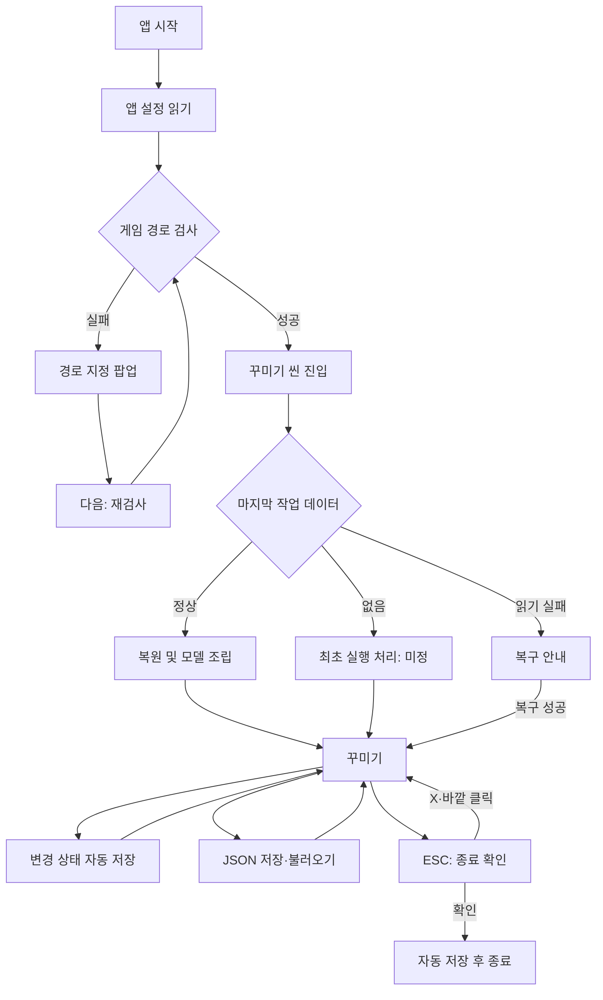

# MobiAtelier 프로그램 흐름 및 화면 기획

> 작성일: 2026-11-01
> 대상: Unity 기반 Windows 빌드.
> 목적: 사용자 PC에 설치된 마비노기 모바일 리소스를 읽어 외형·의상·염색을 미리 확인한다.
> 상태: 사용자 확정 요구사항을 중심으로 정리한 기획 초안. 세부 제안과 미정 사항은 별도 표시한다.

## 1. 요구사항 우선순위

이 문서의 사용자 확정 사항은 ReferenceResearch.md의 이전 제안보다 우선한다. 특히 이전의 좌·중·우 3분할 배치는 고정 요구가 아니며, 이번에는 모델과 카메라 위에 **크기 조절 가능한 꾸미기 창 하나**를 기본으로 한다.

| 구분 | 내용 |
|---|---|
| 확정 | Windows 빌드, 기본 게임 경로 C:\Nexon\MabinogiMobile |
| 확정 | 시작 시 경로 검사, 실패하면 경로 지정 팝업 |
| 확정 | 경로 직접 입력과 Windows 폴더 선택창 지원, 다음 버튼으로 검사 후 진행 |
| 확정 | 꾸미기 씬에서 마지막 편집 상태 복원 |
| 확정 | 현재 편집 상태는 Application.persistentDataPath에 저장 |
| 확정 | 사용자가 꾸미기 데이터를 JSON으로 저장하고 불러오기 |
| 확정 | JSON에는 외형·의상·염색·카메라 등 UI를 제외한 편집 가능한 장면 상태 저장 |
| 확정 | 일반 의상은 부위별 패션장비 ID로 저장하고 시트에서 이름·모델·기본색 조회 |
| 확정 | 외형과 맞지 않는 의상은 선택을 유지하고 미출력, 선택 UI에 빨간색 미적용 표시 |
| 확정 | 다른 의상 선택 시 해당 의상의 기본 염색값 적용, 컬러피커와 HEX 코드 입력 지원 |
| 확정 | 원피스는 상의로 선택하며 착용 시 하의는 출력하지 않음 |
| 확정 | Ctrl+Z 실행 취소·Ctrl+Y 다시 실행 및 대응 버튼 제공 |
| 확정 | 숨겨진 옵션을 켜면 패션장비 데이터가 없는 리소스도 선택 가능 |
| 확정 | 수동 저장 대화상자의 최초 기본 폴더는 프로그램 설치 폴더, 이후 다른 폴더에 저장하면 그 폴더 사용 |
| 확정 | 모델·카메라 및 크기 조절 가능한 꾸미기 창, 드롭다운·검색 중심 선택 |
| 확정 | 앱 창은 고정 해상도·가로세로 비율을 강제하지 않고 자유롭게 크기 변경 |
| 확정 | 꾸미기 창의 마지막 위치·크기 저장 및 복원, 화면 밖으로 나가지 않도록 보정 |
| 확정 | 카메라: 좌 또는 우 단독 드래그는 캐릭터 기준 회전, 좌+우 드래그는 카메라 평면 이동 |
| 확정 | 꾸미기 씬의 ESC는 종료 확인 팝업, 확인 시 종료, X·바깥 클릭 시 취소, 배경 딤 처리 |
| 미정 | 최초 실행에서 배치할 외형·의상 |
| 미정 | 향후 촬영모드의 기능과 화면 |
| 제안 | 마지막 정상 게임 경로 기억, 자동 저장 시점·오류 복구, 키 입력 우선순위 등 아래 세부 규칙 |

사용자 미정 항목은 구현자가 임의로 제품 기본값으로 확정하지 않는다.

## 2. 전체 흐름

※ 다이어그램의 종료 취소 조건은 X 또는 팝업 바깥 클릭이다. 초기 실행·복구 경로의 세부 내용은 5장에 따른다.

## 3. 앱 시작과 게임 경로 검사

### 3.1 검사할 경로

- 최초 기본값: C:\Nexon\MabinogiMobile.
- **제안**: 마지막으로 검사를 통과한 경로를 앱 설정에 저장하고 다음 실행에서 먼저 검사한다. 저장된 경로가 없으면 최초 기본값을 쓴다.
- 검사 성공 없이 입력값만 바뀐 경우에는 마지막 정상 경로를 갱신하지 않는다.
- 원본 게임 파일은 읽기만 한다.

### 3.2 정상 구성의 의미

폴더 존재 여부나 실행 파일 하나의 존재만으로 통과시키지 않는다.

| 검사 단계 | 검사 내용 | 실패 시 동작 |
|---|---|---|
| 경로 | 폴더가 있고 접근 가능한가 | 경로 팝업과 이유 표시 |
| 필수 index | 조립기에 필요한 AssetPackages·ResourcesPackage의 루트·Starter index가 있는가 | 누락 파일 안내 |
| index 형식 | 헤더·레코드를 해석할 수 있는가 | 읽기 실패·지원 불가 안내 |
| 필수 데이터 | 시작에 필요한 정의·시트·리소스의 위치를 찾을 수 있는가 | 누락 데이터 안내 |
| 실제 읽기 | 필요한 blob의 범위를 정상적으로 읽을 수 있는가 | 재검사 안내 |

- 필수 파일 목록은 실제 로더가 사용하는 범위로 관리한다. 저장소 문서만으로 모든 버전의 파일 구성을 하드코딩하지 않는다.
- 최초에는 시작에 필요한 범위를 검사하고, 모든 의상 데이터를 전수 검사하지 않는다.
- 경로 검사 성공과 모든 의상 지원은 별개다. 개별 파츠 오류는 편집 중 별도로 처리한다.
- 런처 패치로 파일 구성이 바뀌었거나 잠시 읽을 수 없으면 실패 이유와 재시도 방법을 알려준다.
- 지원 게임 버전 판정 방식과 버전 표시 위치는 구현 시 구체화한다.

## 4. 경로 지정 팝업

### 4.1 구성

| 요소 | 내용 |
|---|---|
| 제목 | 마비노기 모바일 설치 경로 |
| 설명 | 설치 폴더를 찾지 못했거나 필요한 파일을 읽을 수 없음을 안내 |
| 경로 입력란 | 기본 경로 또는 마지막 입력 경로 |
| 폴더 선택 버튼 | Windows 기본 폴더 선택창 열기 |
| 검사 결과 | 입력란 아래에 누락·접근·형식 오류 표시 |
| 하단 버튼 | 다음 |

문구 예:
- 설치된 마비노기 모바일 폴더를 선택해 주세요.
- 이 폴더에서 필요한 파일을 찾지 못했습니다.
- 파일을 읽지 못했습니다. 게임 패치가 끝난 뒤 다시 시도해 주세요.

### 4.2 상호작용

1. 직접 입력 또는 폴더 선택으로 입력값을 바꾼다.
2. 폴더 선택을 취소하면 기존 입력값을 유지한다.
3. 다음을 누르면 경로 검사를 시작한다.
4. 검사 중 중복 다음 입력을 막고 검사 중 상태를 표시한다.
5. 실패하면 팝업을 유지하고 원인을 표시한다.
6. 성공하면 경로를 기억하고 팝업을 닫은 뒤 꾸미기 씬으로 진행한다.

**제안**
- 입력 앞뒤 공백과 경로를 감싼 따옴표는 정리한다. 경로 중간 공백은 보존한다.
- Enter는 경로 검사 실행으로 연결한다.
- 필수 경로가 정해지기 전에는 팝업 바깥 클릭이나 X로 검사를 우회해 꾸미기 씬에 들어갈 수 없게 한다.
- 시작 화면에서 종료할 수 있는 수단은 제공하되, 시작 화면 종료 UI의 모양은 후속 결정한다.

## 5. 꾸미기 씬 진입과 초기 상태

### 5.1 공통 로딩

- 필요한 index·시트·리소스 로딩 진행 상태를 표시한다.
- 현재 작업 데이터를 읽고, 해당 데이터의 파츠를 해석한 뒤 모델을 조립한다.
- 입력·로딩 실패 상태를 모델이 없는 빈 화면으로만 남겨두지 않는다.

### 5.2 마지막 작업이 있는 경우

- 마지막 정상 편집 상태의 외형·착용 파츠·염색값을 복원한다.
- 꾸미기 창의 마지막 위치·크기를 복원하고 현재 앱 화면 영역 안으로 보정한다(7장).
- 카메라 조작 상태도 복원한다. 외형·장면 데이터와 UI 설정은 저장 구조상 분리한다.
- 복원된 상태는 자동 복원 데이터다. 사용자가 마지막으로 수동 저장한 JSON을 자동으로 덮어쓰지 않는다.

### 5.3 최초 실행

배치할 초기 캐릭터는 **미정**이다.

| 후보 | 장점 | 검토할 점 |
|---|---|---|
| 기본 외형 프리셋 1개 | 바로 조작 가능 | 기본 성별·외형·옷을 정해야 함 |
| 간단한 시작 선택 | 사용자가 외형 기준을 선택 | 시작 단계가 늘어남 |
| 새로 만들기·JSON 불러오기 선택 | 기존 코디 파일로 곧바로 시작 가능 | 신규 사용자에게는 기본 외형이 여전히 필요 |

- 위 후보 중 하나를 아직 확정하지 않는다.
- 2026-11-01 언팩 시트를 추가 조사했다. 아래는 초기 모델 후보의 근거이며 실제 캐릭터 생성 최초 기본값을 확정한 결과는 아니다.

| 후보·자료 | 직접 확인한 값 | 판단 |
|---|---|---|
| CharacterPresetAppearance / FemaleAppearance_Default_01 | Female, Age 17, BodyType Default, HeightModifier 0, Female_Body_00, Head_00, Hair_ShortStraight, Eye_01, Mouth_01, 피부 Color_002·헤어 Color_016·눈 Color_011·입 Default | 기본 여성 외형 후보 |
| CharacterPresetAppearance / MaleAppearance_Default_01 | Male, Age 17, BodyType Default, HeightModifier 1, Male_Body_00, Head_00, Hair_Pompadour, Eye_01, Mouth_01, 피부 Color_002·헤어 Color_009·눈 Color_007·입 Default | 기본 남성 외형 후보 |
| CharacterCustomizeCostumeSet / Female_Archer_01 등 | Top=CustomizePreview_NewbieB_Top_00, Bottom=CustomizePreview_NewbieB_Bottom_00, Shoes=CustomizePreview_NewbieB_Shoes_00 | 단순한 초보자 상하의·신발 조합 참고 |
| CharacterCustomizeDefaultAppearance | Gender·Type·Name별 AdultWeight·ChildWeight 존재 | 단일 고정 외형보다 기본 선택 가중치로 보인다. 실제 사용 알고리즘은 미확인 |
| CharacterPreset | 외형·장비 프리셋 연결, 사내테스트·레벨·치트 등 혼재 | 도구의 초기 상태로 프리셋 전체를 복사하지 말고 외형만 선별 |

- 위 초보자 의상의 InitialEquipmentSheetId는 Clothes_Newbie_Top / Clothes_Newbie_Bottom / Clothes_Newbie_Foot다. 이는 생성 시 초기 장비 참조이며 일반 패션장비 ID라고 확정하지 않는다.
- CustomizePreview_*는 생성 화면 미리보기 항목이다. 신규 사용자 기본 코디로 채택하기 전 일반 Costume 행과의 대응·기본색·실제 조립 가능 여부를 검증한다.
- **추천 후보**: FemaleAppearance_Default_01 외형과 초보자 상하의·신발 스타일. 화려한 직업 의상보다 의상 교체를 확인하기 쉬운 시작점이라는 기획상 제안이며 아직 확정하지 않는다.
- 성인 남녀 두 외형을 기본 프리셋으로 제공하는 대안도 있다. 초기 자동 배치는 하나를 정하고 나머지를 사용자가 고르게 할 수 있다.
- 기술 테스트의 힐러 원피스 모델은 검증용 사례이며 제품 최초 기본값이 아니다.
- 개발 중 임시 프리셋이 필요하면 테스트용임을 구분하고 교체 가능하게 한다.

### 5.4 마지막 작업 복원 실패

**제안**
- JSON 손상·지원하지 않는 형식·찾을 수 없는 파츠를 구분한다.
- 손상된 자동 저장 파일을 빈 값이나 기본값으로 즉시 덮어쓰지 않는다.
- 백업 복구, 다른 JSON 불러오기, 새 작업 중 가능한 경로를 안내한다.
- 일부 파츠만 없는 경우에는 사용 가능한 부분을 복원하고 누락 항목을 알린다. 결과가 불완전하다는 안내 없이 정상 복원처럼 취급하지 않는다.
- 새로 시작하거나 불완전 복원을 수용하기 전까지 기존 복원 파일을 보존한다.

## 6. 저장 체계

### 6.1 자동 저장과 수동 저장 구분

| 구분 | 자동 복원 저장 | 사용자 JSON 저장 |
|---|---|---|
| 목적 | 다음 실행에 마지막 작업 이어가기 | 보관·공유·다른 작업 불러오기 |
| 위치 | Application.persistentDataPath | 사용자가 고른 폴더 |
| 트리거 | 정상 적용된 편집 변경, 종료 확인 | 저장 동작 |
| 기존 파일 | 자동 복원 파일 갱신 | 사용자가 정한 이름으로 저장 |
| 최근 폴더 기억 | 해당 없음 | 저장 성공한 폴더 기억 |

persistentDataPath는 Unity의 정식 API 표기다. 앱 설치 폴더와 게임 설치 폴더, 자동 저장 폴더를 혼동하지 않는다.

### 6.2 자동 저장

**제안**
- 외형·파츠·염색·카메라 변경이 유효한 편집 상태로 확정된 뒤 저장한다. 호환되지 않아 미출력인 의상도 선택 ID·염색값을 보존한다. 잘못된 파일 읽기와 의도적으로 유지한 미적용 선택은 구분한다.
- 슬라이더 드래그나 연속 색 변경마다 디스크에 쓰지 않고, 입력 종료 또는 짧은 유휴 시간 후 합쳐 저장한다.
- 종료 확인 시 대기 중인 변경을 즉시 저장한다.
- 임시 파일로 기록 후 교체하고 직전 정상 파일을 백업한다.
- 앱 설정에는 정상 게임 경로·최근 JSON 폴더·창 배치를 별도로 보관한다.
- 자동 저장 실패는 사용자에게 알리고 메모리의 작업을 유지한다. 수동 JSON 저장으로 보관할 수 있게 한다.
- 강제 종료나 전원 차단에서는 마지막 저장 이후의 변경까지 복구한다고 보장하지 않는다.

### 6.3 사용자 JSON 내용

**확정**: 외형·옷·염색·카메라 등 UI를 제외하고 꾸미기 화면에서 편집할 수 있는 장면 상태 전체를 저장·불러온다. 향후 장면 조작 기능이 추가되면 그 값도 이 원칙에 포함한다. 꾸미기 패널 위치·크기, 앱 설정, 숨겨진 옵션의 ON/OFF는 UI·환경 설정이므로 별도 저장한다.

| 항목 | 내용 |
|---|---|
| 파일 형식 버전 | JSON 구조 호환성 |
| 앱·게임 버전 정보 | 작성 환경 참고 |
| 외형 | 지원하는 외형 ID·나이·체형·색 등 |
| 의상·액세서리 | 부위별 선택한 패션장비 ID, 현재 출력 불가한 선택도 포함 |
| 염색 | 각 선택 파츠의 슬롯별 사용자 설정 색상 |
| 카메라 | 구도를 복원할 위치·회전·거리·팬 등 논리 조작 상태 |
| 기타 장면 상태 | 기능으로 지원하는 포즈·배경·조명 등의 편집값. 아직 없는 기능을 지금 구현하라는 의미는 아님 |

- 일반 의상의 저장 기준은 패션장비 시트 Costume의 Id다. 목록 순번·번들 오프셋·프리팹 경로를 일반 항목의 주 식별자로 쓰지 않는다.
- 로딩 시 ID로 표시 이름·성별별 모델·기본 염색을 조회한다. 사용자 변경 색상이 저장돼 있으면 그 값을 복원한다.
- 모델·텍스처 원본과 로컬 게임 설치 경로를 공유 JSON에 넣지 않는다.
- UI 배치를 불러온 코디 파일 때문에 바꾸지 않는다.
- 호환 여부·원피스에 의한 가림 등 표시 상태는 선택 ID와 외형에서 재계산한다. 미적용 상태를 파일에 저장하기 위해 선택 ID를 지우지 않는다.

**예외 리소스의 식별 제안**
- 패션장비 데이터가 없는 리소스는 가짜 패션장비 ID를 만들지 않는다.
- 부위별 항목에 식별 종류를 두어 일반 항목(costume)과 직접 리소스(resource)를 구분한다.
- 일반 항목은 costumeId, 직접 리소스는 모델 정의의 안정적인 모델 ID·상대 리소스 경로 등 재조회 가능한 키를 저장한다. 구체적인 필드명은 구현 시 확정한다.
- 리소스 항목의 사용자 염색값도 저장한다. 기본색은 조회 가능한 모델·머티리얼 정보로 초기화하고, 없는 기본값을 일반 Costume 기본색이라고 표시하지 않는다.

**중요한 복원 규칙**
- 새로운 의상을 선택하는 동작은 기본색으로 초기화한다.
- JSON 불러오기·자동 복원·실행 취소는 새로운 선택이 아니므로 저장된 색을 그대로 복원한다.

### 6.4 저장 대화상자

1. Windows 기본 파일 저장 대화상자를 연다.
2. 필터와 기본 확장자는 JSON(.json)이다.
3. 저장 이력이 없으면 **MobiAtelier 실행 파일이 있는 폴더**를 연다. Unity의 앱 데이터 폴더나 현재 작업 디렉터리를 의미하지 않는다.
4. 다른 폴더에 저장에 성공하면 그 폴더를 다음 대화상자의 기본 경로로 기억한다.
5. 덮어쓰기는 Windows 대화상자의 확인을 따른다.
6. 취소·저장 실패는 최근 폴더 값을 바꾸지 않는다.
7. 완료하면 저장 성공과 파일명을 간단히 알린다.

**제안**
- 최초 구현은 저장 시 파일 대화상자를 여는 방식으로 단순화한다. Ctrl+S 덮어쓰기·다른 이름으로 저장의 구분은 후속 결정한다.
- 프로그램 폴더에 쓰기 권한이 없으면 실패 이유와 다른 폴더 선택을 안내한다. 저장 위치를 알리지 않고 임의로 바꾸지 않는다.
- 기억한 폴더가 삭제됐으면 접근 가능한 기본 위치로 돌아가 안내한다.

### 6.5 불러오기 대화상자

1. Windows 기본 파일 열기 대화상자를 연다.
2. **제안**: 저장과 공통으로 최근에 저장 성공한 폴더를 시작 위치로 사용한다. 저장 이력이 없으면 프로그램 폴더를 사용한다.
3. 취소하면 현재 작업을 유지한다.
4. 선택한 파일의 JSON 형식·버전·항목을 검사한다.
5. 검증과 새 모델 준비가 성공하면 현재 꾸미기 상태를 교체한다.
6. 성공적으로 적용한 상태는 자동 복원 파일에도 반영한다.
7. 실패하면 기존 작업과 자동 복원 데이터를 유지하고 오류를 표시한다.

불러오기만으로 최근 저장 폴더를 갱신하지 않는 것을 제안한다. 변경할 경우에는 별도 결정한다. 기존 작업을 바꾸기 전에는 자동 복원 백업을 남긴다.

## 7. 꾸미기 씬 화면

### 7.1 기본 구성

- 모델을 배치하는 공간과 모델을 비추는 카메라.
- 그 위에 꾸미기 선택 창 하나를 표시한다.
- 창의 크기를 조절할 수 있다.
- 꾸미기 창은 위치를 옮기고 크기를 조절할 수 있으며, 마지막 위치·크기를 저장·복원한다.
- 앱 창과 꾸미기 창은 서로 다르다. 앱 창은 Windows 창이고 꾸미기 창은 앱 안의 UI 패널이다.

### 7.1.1 앱 창의 자유로운 크기 변경

**확정**
- 앱이 정한 고정 해상도·종횡비로 제한하지 않는다. 세로로 긴 창과 가로로 넓은 창을 모두 지원한다.
- 앱에서 임의의 최소 크기나 비율 제한을 추가하지 않는다. Windows와 Unity가 허용하는 물리적 범위는 따른다.
- 창 크기가 바뀌면 카메라 뷰포트와 UI가 현재 클라이언트 영역에 맞춰 갱신된다.
- 참고 캡처는 서로 다른 화면비에 대응하는 예시다. 캡처 해상도를 제품 해상도로 고정하거나 촬영 UI 전체를 그대로 복제하라는 의미는 아니다.

**구현 참고·제안**
- Unity Windows Player의 Resizable Window 설정으로 창 크기 변경을 활성화한다. 세로·가로 화면의 UI 재배치와 패널 보정은 별도로 구현·검증한다.
- 렌더링 화면을 강제로 늘려 캐릭터 비율을 왜곡하지 않는다.
- 세로 창에서 캐릭터가 잘리는 것을 막기 위한 FOV·거리 자동 보정 정책은 별도 조정한다. 창 크기 변경만으로 사용자의 카메라 조작값을 임의 초기화하지 않는 것을 제안한다.
- 아주 작은 앱 창에서는 UI 스크롤·접기 등으로 조작부에 접근하게 한다. 고정 UI 폭을 유지하기 위해 앱 창을 다시 강제로 키우지 않는다.
- 앱 자체의 마지막 Windows 창 위치·크기 기억은 이번에 확정한 꾸미기 패널 복원과 별개이며 후속 결정한다.

### 7.1.2 꾸미기 창 저장·복원과 화면 안 보정

**확정**
- 이동·크기 조절을 마친 패널의 위치·크기를 앱 설정으로 Application.persistentDataPath에 보관한다.
- 다음 꾸미기 씬 진입 시 해당 값을 읽어 복원한다.
- 패널이 앱의 표시 영역 밖으로 나가 찾을 수 없는 상태를 허용하지 않는다.
- 최초 복원뿐 아니라 앱 창 축소·최대화·복원·화면비 변경 때에도 보정한다.

**보정 순서 제안**
1. 저장된 값이 없거나 유효하지 않으면 기본 위치·크기를 쓴다. 구체적인 기본값은 미정이다.
2. 현재 Canvas 좌표의 사용 가능한 영역과 패널 크기를 비교한다.
3. 패널이 앱 화면보다 크면 먼저 화면에 들어오는 크기로 줄인다.
4. 그다음 패널의 위치를 보정해 전체 패널이 화면 안에 들어오게 한다.
5. 제목·이동 영역, 저장·불러오기 버튼과 크기 조절 핸들이 계속 접근 가능한지 확인한다.
6. 패널의 내용이 공간보다 크면 내부 스크롤로 접근하게 한다. UI의 권장 최소 크기가 앱의 자유로운 크기 변경을 막지 않게 한다.

- 이동·리사이즈 중에도 범위를 제한한다. 좌표는 데스크톱 절대 좌표가 아닌 앱 내부 Canvas 영역을 기준으로 해석한다.
- DPI·UI 배율이 바뀐 경우에도 실제 표시 영역을 기준으로 보정한다. 좌표의 저장 단위·정규화 방식은 구현에서 결정한다.
- 해상도 변경 중 매 프레임 저장하는 대신 이동·리사이즈 완료 또는 안정된 시점에 저장하는 것을 제안한다.
- 화면 축소 때문에 보정된 배치를 새 마지막 배치로 저장할지, 확대 시 원래 배치로 돌아갈지는 후속 결정한다. 어느 방식이든 화면 안 접근 가능 조건이 우선이다.

### 7.2 꾸미기 창 구성 제안

| 영역 | 내용 |
|---|---|
| 제목 영역 | 창 제목, 이동 영역 |
| 공통 작업 | JSON 저장·불러오기, 실행 취소(Ctrl+Z)·다시 실행(Ctrl+Y) 버튼 |
| 분류 탭 | 외형 / 의상 / 염색 |
| 선택 영역 | 부위별 검색 가능한 드롭다운 |
| 상세 영역 | 현재 선택 이름·아이콘·색상 등 |
| 하단·가장자리 | 크기 조절 핸들 |

창 위치·최소 크기·탭 명칭·픽셀 단위 레이아웃은 미정이다.

### 7.3 검색 가능한 드롭다운

Prilus의 이름 검색과 부위별 선택을 참고하되, 이번 제품은 드롭다운·검색을 중심으로 구성한다.

- 선택 필드에는 현재 항목 이름을 표시한다.
- 목록을 열면 검색란과 후보 목록을 표시한다.
- **제안**: 기본 검색은 한글 표시 이름의 부분 일치다. 초성·복합 조건 검색은 후속 기능으로 둔다.
- 후보가 많으면 스크롤하고, 가능하면 아이콘을 함께 보여준다.
- 결과 없음과 빈 슬롯을 구분한다.
- 외형 변경으로 기존 의상이 호환되지 않아도 해당 선택을 유지한다. 목록 필터 정책과 이미 선택된 항목의 보존은 구분한다.
- 착용 해제는 해당 부위가 비어도 되는 경우에 제공한다.
- 선택하면 모델에 반영한다. 별도 적용 버튼을 두지 않는 것을 제안한다.
- 로딩 실패 시 이전 선택을 유지한다.
- 목록을 닫거나 검색을 취소한 것만으로 현재 착용을 바꾸지 않는다.
- 항목 선택으로 발생한 클릭이 카메라 입력으로 이어지지 않게 한다.
- 키보드 방향키·Enter 선택과 ESC 닫기를 지원하는 것을 제안한다.

### 7.4 염색

- 현재 의상과 실제 연결된 염색 부위를 선택한다.
- **확정**: 컬러피커와 HEX 코드 입력을 모두 제공한다. 예: #FF00FF.
- 두 입력은 같은 값을 편집하며 서로 동기화한다. 일반 색 코드 입력은 #RRGGBB를 기준으로 하고 알파 편집 필요 여부는 별도 검토한다.
- 입력 중인 불완전한 코드·잘못된 값은 기존 색을 덮어쓰지 않고 오류를 안내한다.
- RGB 숫자 입력의 별도 제공은 후속 제안이다.
- **확정**: 다른 의상을 선택하면 그 의상의 기본 염색값으로 초기화한다. 일반 의상은 Costume.DyeColor0~5와 모델 DyeInfo의 연결을 사용한다.
- 의상별 슬롯 수·존재 여부를 확인한다. 슬롯 번호가 같다는 이유로 이전 옷의 색을 자동 복사하지 않는다.
- 부위 기본색 복원과 변경 부위 강조는 레퍼런스 기반 제안이다.
- 피부·헤어 색이 외형 탭과 염색 탭에 중복 노출될 경우 같은 상태를 편집하도록 한다.
- 부위 이름이 확인되지 않으면 임의의 의미를 붙이지 않고 번호·강조로 구분한다.
- 즐겨찾기·A/B·팔레트 등은 이 문서의 필수 흐름에 자동 추가하지 않는다.

### 7.5 선택 상태와 실제 출력의 분리

**확정**
- 외형 변경으로 입힐 수 없어진 의상을 자동 해제하거나 다른 의상으로 대체하지 않는다.
- 해당 패션장비 ID와 사용자 염색값을 유지하되 모델은 출력하지 않는다.
- 선택 필드의 의상명을 빨간색으로 표시하고 적용되지 못한다는 안내를 붙인다.
- **제안**: 색만으로 상태를 구분하지 않도록 미적용 표시와 사유(성별·체형에 맞는 모델 없음 등)를 함께 제공한다.
- 호환 가능한 외형으로 돌아오면 유지한 선택·염색으로 다시 출력한다.
- UI와 JSON은 선택 상태를 보존하고, 렌더러는 현재 외형에서 출력 가능한 결과만 만든다.

### 7.6 원피스와 하의

**확정**
- 원피스를 별도 착용 부위로 만들지 않고 상의로 선택한다.
- 원피스 상의가 실제 적용되면 하의는 입지 않은 것처럼 출력하지 않는다.
- **제안**: 하의 선택 ID·염색값은 보존하고 UI에 상의에 의해 가려짐을 표시한다. 원피스를 일반 상의로 바꾸면 기존 하의를 다시 표시한다.
- 외형에 맞지 않아 원피스 자체가 미적용이면 그 원피스의 하의 숨김 효과도 적용하지 않는 것을 제안한다.
- 원피스 판단은 이름에 원피스가 있는지 검색하는 방식이 아니라 시트·모델의 부위 및 숨김 정보(예: HidingParts)로 한다.
- 상의로 가려진 상태와 외형에 맞지 않아 적용할 수 없는 상태는 구분한다.

### 7.7 실행 취소·다시 실행

**확정**
- Ctrl+Z: 실행 취소. Ctrl+Y: 다시 실행.
- 꾸미기 창의 공통 작업 영역에 같은 동작의 버튼을 제공한다. 실행할 이력이 없으면 비활성 표시한다.

**이력 처리 제안**
- 외형·의상·염색 변경을 지원한다. 외형 변경과 그에 따른 의상 표시 재평가는 한 작업으로 복원한다.
- 의상 교체와 기본 염색 초기화도 한 작업이다. 취소하면 이전 의상과 그 사용자 염색값이 함께 돌아온다.
- 컬러피커 연속 드래그는 한 번의 편집 묶음으로 처리하고 색 코드 입력은 확정 시 기록한다.
- 취소한 뒤 새 편집을 하면 다시 실행 분기는 비운다.
- 카메라를 저장한다는 요구와 카메라를 실행 취소 이력에 넣는 것은 별개다. 카메라·JSON 불러오기의 이력 포함 여부는 별도 결정한다.
- 텍스트 입력에 포커스가 있으면 해당 입력란의 편집 취소와 전역 코디 실행 취소가 동시에 실행되지 않게 한다.
- UI 패널 이동·크기 변경은 코디 이력에서 제외하는 것을 제안한다.

### 7.8 숨겨진 리소스 선택 옵션

**확정**
- 기본은 패션장비 데이터가 있는 항목을 선택한다.
- 숨겨진 추가 옵션을 켜면 패션장비 시트에 없는 모델 리소스도 선택할 수 있게 한다.
- 옵션의 진입 방식·이름·단축키는 아직 미정이다. 임의의 숨김 키를 확정하지 않는다.

**세부 제안**
- 리소스의 모델 ID·부위·경로 등 확인 가능한 정보를 표시하고 일반 패션장비와 구분한다.
- 가능한 조립용 모델 정의를 중심으로 탐색한다. 존재하는 모든 메시 파일이 캐릭터에 착용 가능한 것은 아니다.
- 정상 조립 불가·호환 불가는 기존 선택 보존과 미적용 안내 원칙으로 처리한다.
- 옵션 OFF는 추가 리소스의 목록 노출을 끄는 것으로 한다. 이미 선택·저장된 리소스를 삭제하거나 JSON을 훼손하지 않는 것을 제안한다.
- 옵션 OFF에서 직접 리소스가 든 JSON을 열면 항목을 보존하고 리소스 선택 사용 중임을 표시한다. 추가 탐색 UI는 계속 숨긴다.
- 정확한 로딩 실패는 정상 호환 불가와 구분하고 기존 정상 장면을 보호한다.

## 8. 카메라 조작

### 8.1 기준과 근거

2026-11-01 사용자가 직접 설명한 마비노기 모바일의 조작을 기준으로 확정한다. 마우스 좌버튼은 원본 게임의 캐릭터 이동 기능 대신 이 프로그램에서 우버튼과 같은 카메라 회전에 사용한다.

| 입력 | MobiAtelier 동작 | 상태 |
|---|---|---|
| 우버튼만 누르고 드래그 | 캐릭터 기준점을 중심으로 카메라 회전 | 확정 |
| 좌버튼만 누르고 드래그 | 우버튼과 같은 카메라 회전, 캐릭터 이동 없음 | 확정 |
| 좌+우버튼을 누르고 드래그 | 카메라 화면의 좌우·상하 방향으로 평행 이동 | 확정 |
| 마우스 스크롤 | 카메라 확대·축소 | 입력 확정, 방향·감도·범위 조정 |
| 회전 감도·반전·상하 제한 | 게임 느낌을 참고해 조정 | 미정 |

좌+우 이동은 월드 XY에 고정하는 의미가 아니다. 카메라가 Z방향을 보는 예에서는 XY 이동이며, 일반적으로 현재 카메라의 right/up 방향을 사용한다. 드래그로 카메라 전후 이동이나 캐릭터 이동을 하지 않는다.

### 8.2 회전 중심과 평행 이동의 관계

**확정**
- 회전 기준은 캐릭터다. 기준점의 몸 기준 높이는 구현 중 조정한다.
- 좌+우 드래그로 구도를 옮겨도 회전 기준점을 이동된 화면 중심이나 임의의 팬 위치로 바꾸지 않는다.
- 이후 좌 또는 우 단독 드래그로 회전하면 다시 캐릭터 기준점 주위의 회전으로 처리한다.
- 회전할 때 캐릭터 모델 자체를 돌리거나 움직이는 방식으로 대체하지 않는다.

**필수 동작 예**
1. 캐릭터를 보고 우버튼 드래그로 회전한다.
2. 좌+우 드래그로 카메라를 옆·위로 옮겨 구도를 바꾼다.
3. 좌 또는 우 단독 드래그로 다시 회전한다.
4. 회전 중심은 여전히 캐릭터다. 2단계의 이동 위치를 새 회전 중심으로 쓰면 안 된다.

**남은 조정**
- 팬 이후 회전 시작 시 팬 오프셋을 어떻게 유지·해제·보간할지는 게임 실동작과 비교해 결정한다. 캐릭터를 화면 중앙으로 즉시 스냅하는 동작은 이번 요구에서 확정하지 않았다.
- 팬·회전 감도, 카메라 충돌·상하각·이동 범위, 확대·축소는 별도 조정한다.
- 공식 가이드의 0.5x·1x·3x 줌 버튼 존재는 참고 정보이며, 앱에서 해당 버튼을 채택하는지는 별도 결정한다.

**버튼 전환 처리 제안**
- 카메라 입력을 받는 드래그에서는 양 버튼 조합이 단독 버튼보다 우선한다.
- 단독 드래그 도중 다른 버튼을 추가로 누르면 팬으로, 한 버튼을 놓으면 남은 버튼의 회전으로 전환한다.
- 전환 순간 포인터 기준값을 갱신해 위치·각도가 튀거나 같은 이동량이 두 번 적용되지 않게 한다.
- 단, UI에서 시작한 드래그는 버튼을 추가해도 카메라 제어로 넘어가지 않는다.

### 8.3 UI와 입력 충돌 방지

**제안**
- 꾸미기 창·드롭다운·팝업·파일 대화상자를 조작할 때 카메라 입력을 차단한다.
- 목록 위 휠은 목록 스크롤에만 사용한다.
- 창 이동·크기 변경 중에는 카메라가 움직이지 않는다.
- 드래그 시작 대상을 종료까지 유지해 창 밖으로 포인터가 나가도 갑자기 카메라 조작으로 전환되지 않게 한다.
- 앱이 포커스를 잃으면 진행 중인 드래그를 해제한다.

## 9. 종료 확인 팝업

### 9.1 확정 동작

- 꾸미기 씬에서 ESC를 누르면 종료 확인 팝업을 연다.
- 문구: **종료하시겠습니까?**
- 확인 버튼: 종료 진행.
- 팝업 X: 취소.
- 팝업 바깥 영역 클릭: 취소.
- 팝업 뒤 화면은 살짝 어둡게 딤 처리한다.
- 취소하면 현재 모델·선택·카메라 상태를 그대로 유지한다.

### 9.2 제안하는 세부 동작

- 딤 영역이 뒤 UI와 카메라 입력을 막는다. 바깥 클릭은 닫기에만 쓰고 뒤 화면으로 전달하지 않는다.
- 팝업이 열린 상태의 ESC는 취소한다.
- 종료를 여는 ESC와 Enter의 같은 입력 이벤트로 확인까지 실행되지 않게 한다.
- 확인 후 자동 저장이 끝나면 종료한다.
- 자동 저장 실패 시 종료를 보류하고 재시도·수동 JSON 저장·저장 없이 종료의 명시적 선택을 제공한다.
- 창 닫기 버튼과 Alt+F4도 같은 종료 확인 흐름으로 연결한다.
- 강제 프로세스 종료까지 이 흐름으로 처리할 수 있다고 보장하지 않는다.

### 9.3 ESC 우선순위 제안

| 현재 상태 | ESC |
|---|---|
| Windows 파일·폴더 대화상자 | 해당 대화상자의 기본 취소 |
| 종료 팝업 | 팝업 취소 |
| 다른 모달 팝업 | 해당 팝업 닫기·취소 |
| 열린 드롭다운 | 드롭다운만 닫기 |
| 위 요소가 없는 꾸미기 씬 | 종료 확인 열기 |

검색 중이어도 목록이 닫혀 있고 다른 팝업이 없다면 다음 ESC는 종료 확인을 연다. 같은 ESC 이벤트가 두 단계를 동시에 처리하지 않게 한다.

## 10. 후속 촬영모드

촬영모드는 **검토 예정**이며 이번 기본 흐름에 포함하지 않는다.

- 캡처 저장, UI 숨김, 화면비, 포즈·표정, 배경·조명 등의 후보를 별도로 검토한다.
- 꾸미기 카메라가 게임 촬영모드 조작을 사용한다는 것과 촬영 기능 전체를 구현한다는 것은 구분한다.
- 캡처 저장 폴더 정책은 JSON 저장 폴더와 자동으로 공유하지 않는다.
- 사진 모드와 스튜디오 모드의 구분을 그대로 제품에 적용할지는 미정이다.

## 11. 주요 검수 시나리오

| 시나리오 | 기대 결과 |
|---|---|
| 기본 경로 정상 | 경로 팝업 없이 꾸미기 씬으로 진행 |
| 기본·저장 경로 없음 | 경로 지정 팝업 표시 |
| 잘못된 경로 후 다음 | 원인 안내, 씬 진행 안 함 |
| 폴더 선택 취소 | 기존 입력값 유지 |
| 정상 경로로 변경 후 다음 | 검사 성공 후 진행 |
| 마지막 정상 작업 있음 | 외형·의상·염색 복원 |
| 최초 실행 | 미정인 시작 정책을 따로 결정한 뒤 검수 |
| 자동 저장 JSON 손상 | 기존 파일 보존, 복구 안내 |
| 편집 후 재실행 | 마지막 자동 저장 상태 복원 |
| 다른 폴더에 JSON 저장 | 다음 저장 대화상자에서 해당 폴더 열림 |
| JSON 저장 취소·실패 | 현재 작업과 최근 저장 폴더 유지 |
| 올바르지 않은 JSON 불러오기 | 현재 작업 유지, 오류 표시 |
| 정상 JSON 불러오기 | 외형·선택 의상·사용자 염색·카메라 등 장면 상태 복원, UI 배치 유지 |
| 외형 변경으로 의상 미적용 | 선택 ID·염색 보존, 모델 미출력, 선택 필드 빨간색 안내 |
| 호환 외형으로 복귀 | 유지한 의상·염색 다시 표시 |
| 다른 옷 선택 | 새 옷의 기본 염색 적용 |
| 컬러피커·HEX 입력 | 같은 색으로 동기화, 잘못된 코드는 미적용 |
| 원피스 상의 착용 | 하의 미출력, 선택 유지는 제안 정책 검수 |
| Ctrl+Z·Ctrl+Y 및 버튼 | 같은 실행 취소·다시 실행 동작 |
| 숨겨진 옵션 ON | 시트 없는 모델 리소스도 탐색·선택 |
| 직접 리소스 코디 저장·복원 | 리소스 참조·색 유지, 일반 패션장비 ID와 구분 |
| 드롭다운 위 휠·창 크기 조절 | 카메라 입력 발생 안 함 |
| 세로로 긴 앱 창·가로로 넓은 앱 창 | 화면비를 강제하지 않고 정상 표시 |
| 꾸미기 창 이동·크기 변경 후 재진입 | 마지막 배치 복원 |
| 저장 당시보다 작은 앱 창 | 패널 크기·위치 보정, 조작부 접근 가능 |
| 창 축소·확대·DPI 변경 | 패널이 앱 화면 밖으로 사라지지 않음 |
| 좌 또는 우 단독 드래그 | 둘 다 캐릭터 기준 카메라 회전, 모델 이동 없음 |
| 좌+우 드래그 | 카메라 right/up 방향 팬, 전후 이동 없음 |
| 팬 이후 다시 회전 | 이동된 팬 위치가 아닌 캐릭터 기준 회전 |
| 단독↔양 버튼 전환 | 카메라 튐·중복 입력 없음 |
| 열린 목록에서 ESC | 목록만 닫힘 |
| 일반 화면에서 ESC | 딤 처리된 종료 팝업 표시 |
| 팝업 X·바깥 클릭 | 취소, 뒤 화면 입력 발생 안 함 |
| 종료 확인 | 자동 저장 후 종료 |

## 12. 남은 결정

1. 최초 실행의 초기 외형·의상과 선택 화면 유무.
2. 카메라 감도·제한·스크롤 방향 및 팬 이후 회전 시 오프셋 처리. 스크롤 확대축소 입력·버튼 매핑·캐릭터 회전 중심은 확정.
3. UI 제외 장면 상태 전체를 담는 JSON 파일 구조와 직접 리소스 참조 키. 카메라 포함은 확정.
4. 꾸미기 창 최소 크기·초기 위치·리사이즈 방식.
5. 세부 제안의 채택 범위: 최근 경로 기억, 단축키, 저장 오류 처리, 앱 자체의 Windows 창 배치 복원. 꾸미기 패널 배치 복원은 확정.
6. 향후 촬영모드 범위.
7. 숨겨진 리소스 옵션의 진입 방식과 카메라·불러오기 실행 취소 범위.

## 13. 참고 자료

- [레퍼런스 조사](ReferenceResearch.md): 비교 자료이며 확정 사양은 이 문서의 사용자 확정 항목을 우선한다.
- [Prilus 캐릭터 시뮬레이터](https://prilus.gitlab.io/ko/charsimul): 이름 검색·부위별 선택·염색·부분 복원 UX.
- [마비노기 캐릭터 시뮬레이터](https://mabi.sigkill.kr/charsimulator/): 외형 선택과 부위별 의상·염색 흐름.
- [마비노기 모바일 공식 촬영모드 가이드](https://mabinogimobile.nexon.com/Info/Guide/3148768): 촬영·스튜디오 기능. 원문은 2025-09-25 게임 상황 기준이며 2026-11-01 확인. 정확한 마우스 바인딩 근거로 사용하지 않는다.
- [Unity Application.persistentDataPath](https://docs.unity3d.com/6000.3/Documentation/ScriptReference/Application-persistentDataPath.html): 자동 복원 데이터 저장 위치.
- [언팩 저장소 PhotoMode 선언](https://github.com/PieceOfPaper/MabinogiMobileUnpack/blob/46e94a82112243850d68a39cde73890de016140d/Dump/MM.Client.Presentation/MM.Client.Presentation.UI.Components.PhotoMode.cs): 줌 관련 선언 참고. 입력 처리 구현을 확인한 자료는 아니다.

### 추가 근거: 창 크기와 카메라

- 사용자 제공 캡처: `20261101_215743028_MabinogiMobile.png`(세로), `20261101_215747813_MabinogiMobile.jpg`(가로). 화면비 대응 참고용이며 이 문서에는 이미지 파일을 추가하지 않았다.
- 사용자 설명(2026-11-01): 우버튼 회전, 좌+우 화면 평행 이동, 팬 이후에도 캐릭터 중심 회전. MobiAtelier의 좌버튼은 우버튼과 같은 회전으로 변경한다.
- [Unity PlayerSettings.resizableWindow](https://docs.unity.com/en-us/engine/6000.3/script-reference/unityeditor/playersettings/resizablewindow): Windows 플레이어 창 크기 변경 설정. UI 자동 재배치까지 이 설정이 해결해 주는 것은 아니다.

### 추가 근거: 최초 모델 후보와 장비 식별

- [CharacterPresetAppearance](https://github.com/PieceOfPaper/MabinogiMobileUnpack/blob/main/Patch/Sheetdata/client/CharacterPresetAppearance.json): 성인 남녀 기본 외형 후보. 이번에 119행의 추출 시트를 확인했다. 실제 최초 선택 알고리즘까지 확인한 것은 아니다.
- [CharacterCustomizeCostumeSet](https://github.com/PieceOfPaper/MabinogiMobileUnpack/blob/main/Patch/Sheetdata/client/CharacterCustomizeCostumeSet.json): 초보자 생성 미리보기 의상과 초기 장비 연결. 일반 패션장비 ID 대응은 추가 검증한다.
- [CharacterCustomizeDefaultAppearance](https://github.com/PieceOfPaper/MabinogiMobileUnpack/blob/main/Patch/Sheetdata/client/CharacterCustomizeDefaultAppearance.json): 외형 후보별 AdultWeight·ChildWeight.
- [CharacterPreset](https://github.com/PieceOfPaper/MabinogiMobileUnpack/blob/main/Patch/Sheetdata/client/CharacterPreset.json): 외형·장비 프리셋 참조. 사내테스트 데이터 혼재에 주의한다.
- [CharacterSimulator 분석 문서](https://github.com/PieceOfPaper/MabinogiMobileUnpack/blob/main/Docs/CharacterSimulator.md): Costume 기본색, 성별 모델, HidingParts와 원피스 사례 참고.
