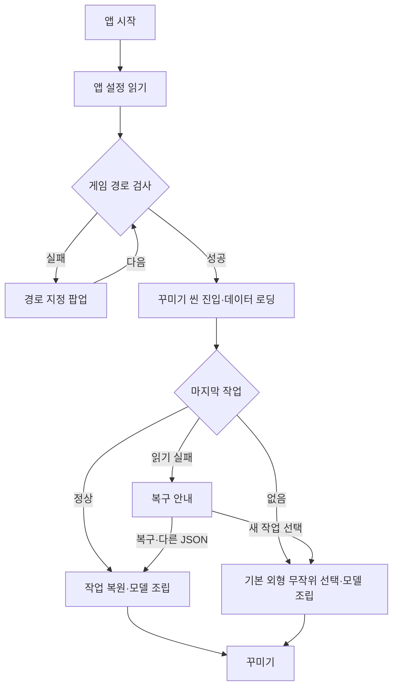
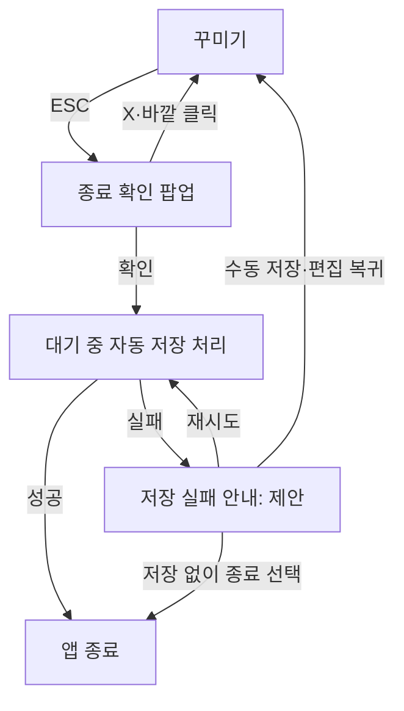

# MobiAtelier 프로그램 플로우

> 정리일: 2026-11-02
> 앱 시작부터 꾸미기·저장·종료까지의 화면·상태 전환만 다룬다.
> UI 배치·데이터 구조·입력 규칙은 연결된 세부 기획서를 따른다. 확정·제안·미정 상태도 각 문서에 유지한다.

## 1. 시작과 꾸미기 진입

- 경로 검사에 실패하면 지정 팝업을 유지하고, 재검사에 성공해야 씬으로 진행한다.
- 마지막 작업이 있으면 복원한 뒤 편집을 시작한다.
- 마지막 작업이 없는 최초 실행에는 두 기본 외형 프리셋 중 하나를 무작위로 선택해 편집을 시작한다. 구체적인 초기값은 시작 설정 기획서를 따른다.
- 복원 실패 시 복구·다른 JSON·새 작업의 경로를 제공한다. 일부 누락·공개 제한은 안내 후 부분 복원 여부를 선택한다. 실패 안내에서 정상 편집으로 바로 진행하지 않는다.

세부: [시작 설정·경로·최초 캐릭터](Startup.md).

## 2. 꾸미기 중 상태 전환

| 시작 상태 | 입력·이벤트 | 처리 후 상태 |
|---|---|---|
| 꾸미기 | 외형·의상·염색 변경 | 적용 가능 여부 평가 → 장면·선택 UI 갱신 → 자동 저장 대상으로 확정 |
| 꾸미기 | 카메라 조작 | 장면 상태 갱신 → 자동 저장 대상으로 확정 |
| 꾸미기 | 렌즈 화각 선택 | 화각 상태 갱신 → 자동 저장 대상으로 확정 |
| 꾸미기 | UI 숨김·복귀 | UI 표시 상태 전환 → 동일 작업에서 감상·편집 계속 |
| 꾸미기 | 실행 취소·다시 실행 | 이력에서 상태 복원 → 장면·선택 UI 갱신 |
| 변경된 작업 | 자동 저장 시점 도달 | 자동 저장 → 꾸미기 계속 |
| 꾸미기 | JSON 저장 | 저장 대화상자 → 성공·취소·실패 안내 → 기존 편집 계속 |
| 꾸미기 | JSON 불러오기 | 열기 대화상자 → 검증·모델 준비 → 성공 시 작업 교체, 취소·실패 시 기존 작업 유지 |
| 꾸미기 | 초기화 | 기준 상태·모델 준비 → 성공 시 장면 교체·실행 취소 및 다시 실행 이력 삭제, 취소·실패 시 기존 작업·이력 유지 |
| 꾸미기 | 창 크기 변경 | 표시 영역 갱신 → 꾸미기 창 보정 → 편집 계속 |

JSON 불러오기가 성공하면 실행 취소·다시 실행 이력을 비우고 새 기준으로 편집한다. 취소·실패 시 기존 이력을 유지한다. 초기화는 확인 팝업을 거쳐 현재 성별의 기본 외형·초보자 의상·기본 카메라를 적용한다. 이력 범위와 초기화 기준의 세부는 [실행 취소](UndoRedo.md)와 [초기화](Reset.md)를 따른다.

세부: [의상·리소스](Equipment.md), [염색](Dye.md), [카메라](Camera.md), [실행 취소](UndoRedo.md), [저장·불러오기](SaveLoad.md), [창·UI](WindowAndCustomizationUI.md).

## 3. 종료

- 종료 확인 취소 시 현재 작업을 유지한다.
- 열린 드롭다운·모달·Windows 대화상자의 ESC 처리, 창 닫기·Alt+F4 연동과 저장 실패 처리는 세부 기획서의 제안을 따른다.

세부: [종료 팝업·ESC 우선순위](ExitPopup.md), [저장·불러오기](SaveLoad.md).

## 4. 향후 확장

독립 촬영모드는 후속 검토다. UI 숨김과 렌즈 화각은 꾸미기에서 바로 사용한다. 카메라 쳐다보기·행동은 구현 가능성을 검증한 뒤 도입하며, 별도 모드가 필요하면 그때 진입·복귀 플로우를 추가한다.

세부: [촬영모드 후속 검토](PhotoMode.md).
