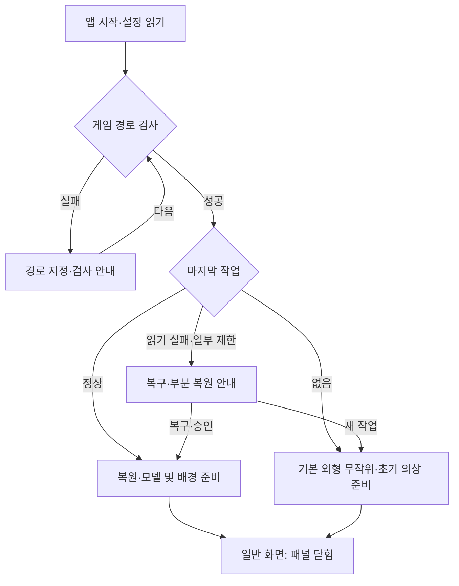
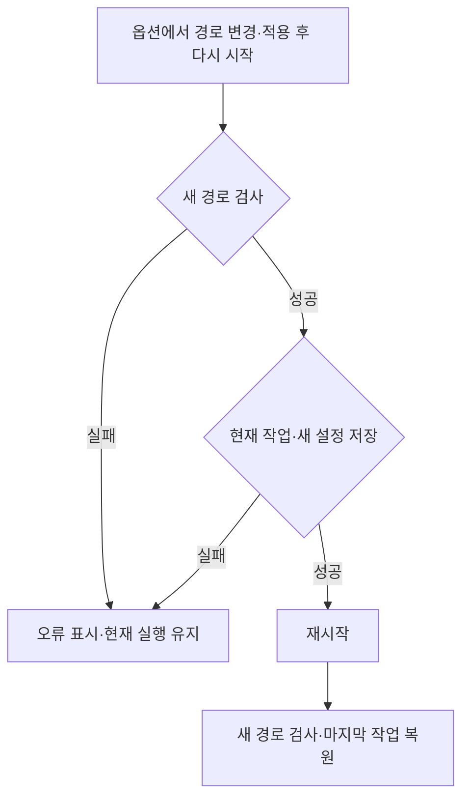
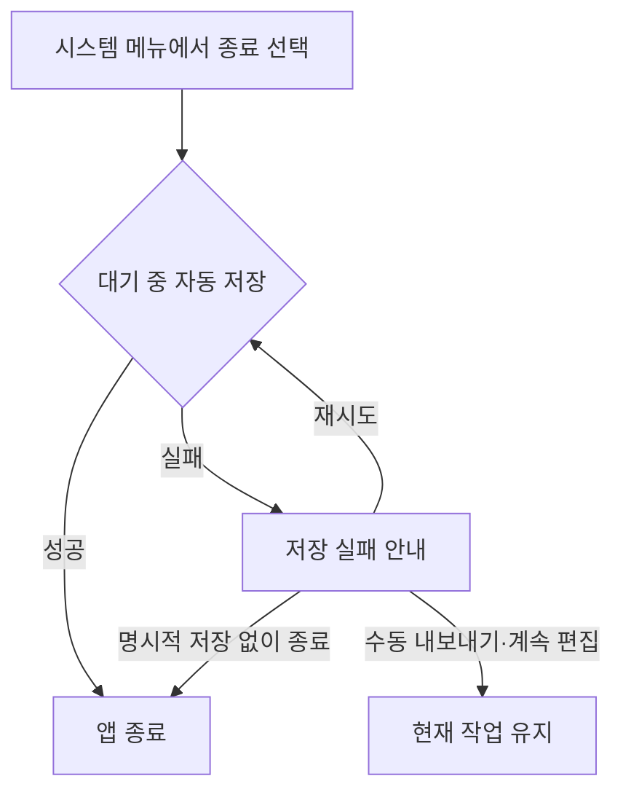

# MobiAtelier 프로그램 플로우

> 정리일: 2026-11-03
> 앱 시작·편집·패널·시스템 메뉴·옵션·종료의 상태 전환만 다룬다. 배치·문구·입력 세부는 연결된 기획서를 따른다.
> 새 흐름은 기획 확정이며 구현 완료가 아니다. 각 세부 문서의 제안은 제안으로 유지한다.

## 1. 시작과 정상 화면 진입

- 마지막 작업의 외형·의상·염색·배경·카메라를 복원한다. 실행 취소 이력은 복원하지 않는다.
- 최초 외형은 기존 두 기본 프리셋의 동일 확률 선택과 초기 의상 정책을 따른다.
- 패널은 닫고 전체 UI를 표시한다. 사용자 카메라를 패널 초기 상태 때문에 다시 기본 구도로 돌리지 않는다.
- 최초 사용 도움말은 정상 미리보기 이후 비모달로 제공하는 제안이다. 경로·복구 안내가 우선이며 도움말 확인을 진입의 필수 단계로 만들지 않는다.

세부: [시작 설정](Startup.md), [배경](Background.md), [조작 안내](ControlsHelp.md).

## 2. 꾸미기·감상·UI 전환

| 시작 상태 | 입력·이벤트 | 처리 후 상태 |
|---|---|---|
| 일반 화면·패널 닫힘 | 가장자리 열기 탭 | 패널 열림 → 남은 카메라 영역으로 갱신 |
| 패널 열림 | 패널 가장자리 닫기 탭 | 패널 닫힘 → 전체 카메라 영역으로 복귀 |
| 일반 화면 | F1·눈 아이콘 | 전체 UI 숨김 → 전체 카메라 영역에서 감상 |
| UI 숨김 | F1·복귀 눈 아이콘 | 숨기기 전 패널·피커·안내 표시 상태 복원 |
| 편집 | 외형·의상·염색·배경 변경 | 준비·검증 → 성공 시 편집·UI·이력·자동 저장 확정 |
| 편집 변경 실패 | 리소스·호환·공개 검사 실패 | 이전 정상 장면·기존 이력 유지, 사유 표시 |
| 일반 화면·패널 열림/닫힘 | 카메라 회전·팬·거리·화각 | 구도·자동 저장 갱신, 꾸미기 이력에는 기록하지 않음 |
| 편집·감상 | 실행 취소·다시 실행 | 꾸미기 값만 복원, 현재 카메라·UI 상태 유지 |
| 변경된 작업 | 자동 저장 시점 | 저장 → 같은 화면 계속 |
| 일반 화면 | 자세한 조작 안내 열기·닫기 | 같은 장면에서 안내만 전환 |

- 패널 여닫기는 출력 영역만 바꾼다. 카메라 회전·팬·거리·화각을 자동 초기화하지 않는다.
- 패널 접기·UI 숨김은 컬러피커 미확정 색과 편집 상태를 보존한다.
- 다른 편집을 시작할 때 현재 미리보던 색을 적용하는 정책은 Dye.md를 따른다.
- UI 숨김 중 ESC는 시스템 메뉴만 임시로 연다. 메뉴를 닫으면 숨김 상태로 돌아온다.

세부: [창·UI](WindowAndCustomizationUI.md), [카메라](Camera.md), [꾸미기 이력](UndoRedo.md), [염색](Dye.md).

## 3. 시스템 메뉴·파일·초기화

| 시작 상태 | 입력·이벤트 | 처리 후 상태 |
|---|---|---|
| 다른 UI가 입력을 소유하지 않는 화면 | 메뉴 버튼·ESC | 시스템 메뉴 열기 |
| 시스템 메뉴 | ESC·닫기 | 메뉴 닫기 → 원래 패널·UI 표시 상태 |
| 시스템 메뉴 | 내보내기(Export) | JSON 내보내기 대화상자 → 저장 성공/취소/실패 → 기존 작업 |
| 시스템 메뉴 | 가져오기(Import) | 파일 선택 → 검사·필요한 부분 복원 확인 → 성공 시 작업 교체·이력 삭제 |
| 시스템 메뉴 | 초기화 | 확인 팝업 → 성공 시 현재 성별 기본 코디·기본 카메라·이력 초기화 |
| 가져오기·초기화 | 취소·실패 | 기존 작업·이력 유지 → 메뉴로 복귀 가능 |
| 시스템 메뉴 | 옵션 | 옵션 화면 |
| 옵션 | 돌아가기·ESC | 미적용 입력을 버리고 메뉴로 복귀 |

메뉴를 여닫는 것은 꾸미기 편집이 아니다. 내보내기는 이력을 유지하고 가져오기·초기화 성공만 새 기준 상태를 만든다. 초기화는 배경을 유지한다. 입력을 가진 드롭다운·피커·옵션·파일 대화상자는 기본 메뉴 전환보다 먼저 처리한다.

세부: [시스템 메뉴](SystemMenu.md), [내보내기·가져오기](SaveLoad.md), [초기화](Reset.md).

## 4. 경로 적용과 재시작

- 입력만 바꾸거나 취소한 경로는 적용하지 않는다. 같은 경로의 불필요한 재시작은 하지 않는다.
- 작업 저장·설정 기록이 실패하면 재시작하지 않는다. 재시작 실패 시 설정·작업을 복구할 수 있게 한다.
- 재시작은 새 실행이므로 실행 취소·다시 실행 이력은 비어 있다. 현재 작업 값은 복원한다.

세부: [옵션](Options.md), [시작 설정](Startup.md).

## 5. 종료

- ESC는 종료 확인을 열지 않는다. 시스템 메뉴의 종료 이후에도 같은 종료 확인 팝업을 추가하지 않는다.
- 저장 실패 안내·초기화 확인·부분 복원 안내는 각각의 용도로 유지한다.
- 창 닫기·Alt+F4를 시스템 메뉴로 연결하는 것은 SystemMenu.md의 제안이다. 강제 종료는 제어 범위 밖이다.

## 6. 조건부 확장

시선·행동은 지원을 검증한 뒤 같은 꾸미기 화면의 연출 카테고리에 추가한다. 미지원 빈 메뉴나 별도 씬을 먼저 만들지 않는다. 독립 촬영모드·이미지 저장 비율·표정 단독 기능은 기존 보류·후속 검토 상태를 유지한다.

세부: [촬영모드](PhotoMode.md), [스튜디오 기능 검토](StudioFeatureReview.md).
