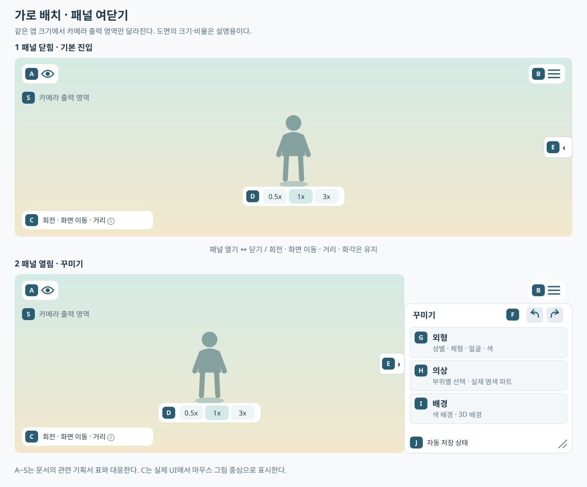
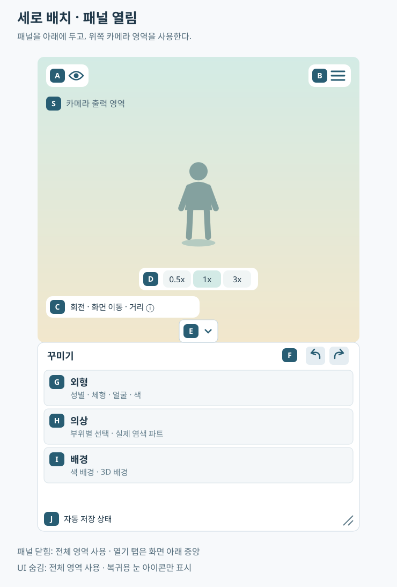
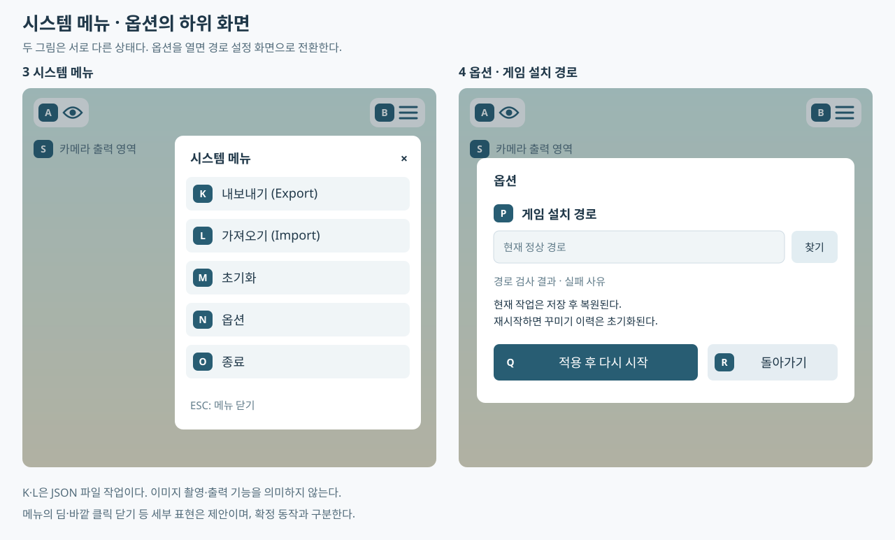

# 화면 배치·접이식 꾸미기 패널 기획

> 정리일: 2026-11-03
> 사용자 결정으로 이전 이동식 창·패널 상단 파일 작업 배치를 대체한다. 기획 확정과 현재 구현은 구분한다.
> 상태 전환은 [프로그램 플로우](ProgramFlow.md), 메뉴는 [시스템 메뉴](SystemMenu.md), 사용법은 [조작 안내](ControlsHelp.md)를 따른다.

## 1. 기본 구성

**확정**
- 캐릭터·배경을 표시하는 카메라 영역과 접이식 꾸미기 패널 하나를 둔다.
- 앱 창의 자유로운 크기 변경은 유지한다. 앱이 임의의 최소 해상도·화면비를 강제하지 않는다.
- 가로 창에서는 오른쪽, 세로 창에서는 아래쪽에 붙는 패널을 사용한다. 기본 UI는 패널을 닫은 상태다.
- 이번 배치에서는 패널을 임의 위치로 끌어 옮기는 기능을 제외한다. 이전 위치 저장값은 새 배치의 위치로 그대로 적용하지 않는다.
- 패널 폭·높이 조절 손잡이는 두지 않는다(2026-11-03 사용자 결정). 패널 크기는 앱 창 크기에서 계산하고, 남은 카메라 영역·토글 버튼이 접근 불가능해지지 않게 보정한다. 폴드아웃은 유지한다.
- 패널이 열려 있어도 남은 카메라 영역에서 회전·화면 이동·거리 조절을 사용할 수 있다.

## 2. UI 배치도와 항목별 기획서

이 문서를 UI 배치의 기준으로 사용한다. 위치·표시 상태는 이 문서에서 정하고, 기능의 값·검사·성공/실패 처리는 아래 연결한 항목별 기획서를 따른다. 상태 전환의 전체 흐름은 [프로그램 플로우](ProgramFlow.md)에서 관리한다.

### 2.1. 배치도 읽기

- 아래 SVG 배치도는 Markdown의 이미지 문법으로 표시한다. 외부 이미지 호스팅이나 Mermaid 지원 없이 저장소 안의 파일을 참조한다.
- 그림의 **A~S 식별자**는 아래 항목별 표와 대응한다. 관련 기획서는 그림 안 대신 Markdown 표에서 클릭한다.
- 그림은 배치 관계를 설명하는 도면이다. 픽셀 크기·패널 비율·색·아이콘 모양·폴드아웃 최초 펼침 상태를 확정하지 않는다.
- 캐릭터 실루엣은 기본 중앙 구도의 예시다. 실제 사용자 팬·회전·거리·화각을 패널 여닫기로 초기화하지 않는다.
- C의 안내 문구는 공간을 나타내는 요약이다. 실제 UI에서는 마우스 버튼 강조 그림과 짧은 글자를 사용한다.
- 새 배치의 구현 완료 화면이 아니다. 아래 시스템 화면의 딤·바깥 클릭 닫기 같은 제안은 [시스템 메뉴](SystemMenu.md)의 상태 구분을 유지한다.

**가로 창: 패널 닫힘 / 열림**

텍스트 기준: A는 앱 왼쪽 위, B는 앱 오른쪽 위에 고정한다. 닫힌 패널의 E는 앱 오른쪽 중앙에 둔다. 패널을 열면 E는 패널 왼쪽 중앙, F·G·H·I·J는 패널 안에 둔다. C·D는 줄어든 S 영역을 따라간다.

**세로 창: 아래쪽 패널 열림**

텍스트 기준: A·B는 앱 상단에 유지한다. 패널을 열면 위쪽을 S, 아래쪽을 꾸미기 패널로 나누고 E는 경계 중앙에 둔다. 패널을 닫으면 전체를 S로 사용하고 E를 앱 아래 중앙에 둔다.

**시스템 메뉴 / 옵션 화면**

텍스트 기준: B에서 연 메뉴 안에 K~O를 순서대로 둔다. N을 선택하면 경로 옵션 P·Q·R로 전환한다. 두 하위 화면을 동시에 여는 배치가 아니다. 옵션에서 R·ESC는 메뉴로, 메뉴에서 ESC는 기존 화면으로 돌아간다.

### 2.2. 기본 화면·꾸미기 패널

| 식별자 | UI 항목 | 위치·표시와 동작 | 관련 기획서 |
|---|---|---|---|
| A | 전체 UI 숨김·복귀 | 앱 왼쪽 위의 눈 아이콘·F1. 숨김 중에도 복귀용 눈은 유지 | [표시 상태](#4-패널-닫기와-전체-ui-숨김), [촬영모드](PhotoMode.md), [조작 안내](ControlsHelp.md) |
| B | 시스템 메뉴 | 앱 오른쪽 위의 메뉴 아이콘·ESC. 패널 열림과 무관하게 접근 | [시스템 메뉴·종료·ESC](SystemMenu.md) |
| C | 빠른 조작 안내·상세 도움말 | 현재 카메라 영역 왼쪽 아래. 마우스 그림·짧은 글자·정보 아이콘 | [조작 안내·도움말](ControlsHelp.md), [카메라 입력](Camera.md) |
| D | 화각 0.5x·1x·3x | 현재 카메라 영역 하단 중앙에서 조금 위. 휠 거리 조절과 별개 | [카메라·화각](Camera.md) |
| E | 꾸미기 패널 열기·닫기 | 가로 닫힘은 앱 오른쪽 중앙, 열림은 패널 왼쪽 중앙. 세로는 아래쪽 가장자리로 대응 | [출력 영역 전환](#3-패널과-카메라-출력-영역), [표시 상태](#4-패널-닫기와-전체-ui-숨김) |
| F | 실행 취소·다시 실행 | 패널 최상단 제목·탭 영역의 아이콘 두 개. 이력 없음은 비활성 | [꾸미기 이력·Ctrl+Z/Y](UndoRedo.md) |
| G | 외형 폴드아웃 | 성별·체형·키·나이·얼굴·헤어·눈·입·꾸밈·외형 색 | [캐릭터 외형 선택](Appearance.md) |
| H | 의상 폴드아웃·의상별 염색 | 부위별 의상·액세서리·무기 선택. 각 의상 아래 실제 염색 파트·피커 | [의상·리소스 선택](Equipment.md), [염색·HEX·피커](Dye.md) |
| I | 배경 폴드아웃 | 색·3D 배경 선택, 적용 상태·대체/실패 사유 | [스튜디오 배경](Background.md) |
| J | 상태 줄 | 패널 아래의 일반 자동 저장 상태. 필수 오류는 밖에서도 표시. 크기 조절 손잡이는 두지 않는다(2026-11-03) | [자동 저장·오류](SaveLoad.md), [UI 설정](#6-크기ui-설정의-저장) |
| T | 소셜 모션 | 현재 카메라 영역 오른쪽 아래. 위로 열리는 검색 목록, 재생 중 이름·정지. 저장·이력 제외 | [소셜 모션](SocialMotion.md) |
| S | 카메라 출력 영역 | 패널 닫힘은 전체, 가로 열림은 왼쪽, 세로 열림은 위쪽 | [출력 영역 전환](#3-패널과-카메라-출력-영역), [카메라](Camera.md), [배경 표시](Background.md) |

### 2.3. 시스템 메뉴·옵션의 항목별 연결

| 식별자 | UI 항목 | 위치·역할 | 관련 기획서 |
|---|---|---|---|
| K | 내보내기(Export) | 시스템 메뉴 첫 항목. 현재 장면을 JSON 파일로 보관 | [내보내기·가져오기](SaveLoad.md) |
| L | 가져오기(Import) | 시스템 메뉴 두 번째 항목. JSON 검사·부분 복원·작업 교체 | [내보내기·가져오기](SaveLoad.md) |
| M | 초기화 | 시스템 메뉴 세 번째 항목. 확인 후 기본 코디·카메라 복원, 배경 유지 | [초기화](Reset.md), [이력 삭제](UndoRedo.md) |
| N | 옵션 | 시스템 메뉴 네 번째 항목. 경로 옵션 화면으로 진입 | [옵션·경로 변경](Options.md) |
| O | 종료 | 시스템 메뉴 마지막 항목. 자동 저장 후 종료, 실패 시 복구 선택 | [시스템 메뉴·종료](SystemMenu.md), [자동 저장](SaveLoad.md) |
| P | 게임 설치 경로·폴더 선택·검사 결과 | 옵션 본문. 현재 정상 경로와 입력 중 경로를 구분 | [옵션](Options.md), [시작 경로 검사](Startup.md) |
| Q | 적용 후 다시 시작 | 옵션 하단 주요 버튼. 경로 검사·작업 저장·설정 기록 성공 후 재시작 | [경로 적용](Options.md), [재시작 흐름](ProgramFlow.md) |
| R | 돌아가기 | 옵션 하단 보조 버튼. 미적용 입력을 버리고 메뉴로 복귀 | [옵션](Options.md), [ESC 입력 소유권](SystemMenu.md) |

### 2.4. 아이콘·미노출 항목

- 눈·메뉴·패널 탭·실행 취소 아이콘에는 툴팁과 키보드 접근 이름을 제공한다. 화각은 숫자 표기를 유지한다.
- 눈 아이콘은 UI 표시 중 열린 눈, 숨김 중 감긴 눈 또는 빗금 친 눈으로 구분한다. 툴팁은 `UI 숨기기 (F1)`·`UI 표시 (F1)`다.
- 시스템 메뉴 내부는 항목 이름도 함께 표시한다. 파일 작업·옵션·종료를 꾸미기 패널 상단에 중복 배치하지 않는다.
- 소셜 모션은 패널이 아니라 카메라 영역의 항목 T다([소셜 모션](SocialMotion.md)). 시선은 검증·도입 후 연출 폴드아웃으로 추가한다. 검증 전 빈 메뉴를 배치도에 넣지 않는다. [스튜디오 기능 검토](StudioFeatureReview.md)를 따른다.
- 별도 카메라 초기화·촬영 버튼·이미지 비율 선택은 이번 배치에 추가하지 않는다. 코디 초기화와 1x 화각 선택의 의미를 구분한다. 보류 범위는 [촬영모드](PhotoMode.md)를 따른다.

## 3. 패널과 카메라 출력 영역

**확정**
- 패널 닫힘: 카메라는 앱의 전체 표시 영역을 사용한다.
- 오른쪽 패널 열림: 패널을 제외한 왼쪽 영역을 사용한다. 기본 중앙 구도의 캐릭터는 앱 화면상 왼쪽에 나타난다.
- 아래쪽 패널 열림: 패널을 제외한 위쪽 영역을 사용한다.
- 패널의 여닫기와 앱 창 크기 변경은 카메라 출력 사각형과 화면비를 갱신한다. 사용자 회전·팬·거리·렌즈 배율과 캐릭터 위치는 유지한다.
- 처음 표시되는 기본 구도는 캐릭터 중심이다. 사용자가 팬으로 옮긴 뒤에는 패널을 여닫았다는 이유로 다시 중앙 정렬하지 않는다.
- 여닫기에 의한 출력 영역 변경은 UI 동작이다. 카메라 편집값이나 꾸미기 이력으로 기록하지 않는다.
- 보기 도구·안내는 현재 출력 사각형을 기준으로 배치한다. 사용자 카메라를 이동해 도구 자리를 만들지 않는다.
- 카메라 입력은 현재 출력 영역에서 시작한 입력만 받는다. 버튼·패널·메뉴에서 시작한 입력과 UI 목록 위 휠은 카메라에 전달하지 않는다.

**구현 세부·검증**
- 출력 영역·화면비 변경으로 캐릭터 비율을 늘려 그리지 않는다. 세로 창에서 출력 높이가 줄면 보이는 크기가 달라질 수 있으므로 별도로 확인한다.
- 기본 거리 자동 맞춤은 최초 구도·명시적 초기화에 사용한다. 패널 여닫기마다 FitSize·ResetView로 구도를 덮어쓰지 않는다.
- 캐릭터·그라데이션·3D 배경·벽 가림 판정과 화각 UI가 같은 카메라 출력 영역을 사용하도록 검증한다.
- 출력 영역이 0 이하가 되지 않게 패널 크기를 보정한다. 내용은 내부 스크롤·접기로 접근하며 앱을 강제로 키우지 않는다.
- 패널 애니메이션 시간과 크기 범위는 구현 중 조정한다. 정확한 픽셀 값은 확정하지 않는다. 2026-11-03 구현: 패널은 약 0.22초 슬라이드하며 카메라 출력 영역도 함께 바뀐다. 메뉴·팝업·안내는 짧은 페이드로 나타나고 사라진다.

## 4. 패널 닫기와 전체 UI 숨김

| 상태 | 카메라 영역 | 남는 UI |
|---|---|---|
| 일반 UI·패널 열림 | 패널을 제외한 영역 | 패널·닫기 탭·눈·메뉴·화각·조작 안내 |
| 일반 UI·패널 닫힘 | 전체 표시 영역 | 열기 탭·눈·메뉴·화각·조작 안내 |
| 전체 UI 숨김 | 전체 표시 영역 | 복귀용 눈 아이콘만. 필수 오류·로딩·복구 안내는 예외 |

- F1·눈 버튼은 전체 UI 숨김/복귀다. 패널 탭은 패널만 여닫는다.
- 전체 UI 숨김 직전의 패널 열림·펼침·피커·자세한 안내 상태를 기억했다가 복귀한다. 재실행 시에는 일반 UI·패널 닫힘으로 시작한다.
- 패널 접기·UI 숨김만으로 미확정 염색을 적용·취소하지 않는다. 피커도 함께 숨겼다가 복원한다.
- 모달·Windows 대화상자가 열렸으면 뒤의 F1 전환을 막는다.
- UI 숨김 중 ESC는 시스템 메뉴를 임시로 연다. 메뉴를 닫으면 UI 숨김 상태로 돌아온다.

## 5. 패널 본문과 이력 버튼

- 최상단은 `꾸미기` 제목과 실행 취소·다시 실행 아이콘이다. 이력 없음은 비활성, 기능은 [꾸미기 이력](UndoRedo.md)을 따른다.
- 외형 → 의상 → 배경 순서로 폴드아웃을 둔다. 하나를 열었다는 이유로 다른 항목의 선택·모델을 지우지 않는다.
- 외형에는 [캐릭터 외형 선택](Appearance.md)의 성별·체형·키·나이·얼굴·헤어·눈·입·꾸밈과 외형 색 시트 선택을 유지한다.
- 의상에는 부위별 의상·액세서리·무기와 해당 의상의 실제 염색 파트를 둔다. 염색을 별도 최상위 메뉴로 분리하지 않는다.
- 배경에는 색·3D 배경 선택과 적용/대체 사유를 둔다. [스튜디오 배경](Background.md)의 공개 제한과 실패 처리 보완을 따른다.
- 시선이 검증·도입되면 연출 폴드아웃을 추가한다(소셜 모션은 패널 밖 항목 T). 지금 빈 메뉴·작동하지 않는 버튼을 노출하지 않는다.
- 표정 단독 선택·무기 표시 전용 옵션·이미지 출력·A/B·즐겨찾기는 기존 보류·제안 상태를 유지한다.

## 6. 크기·UI 설정의 저장

- 패널 위치·크기는 고정된 가장자리 배치와 앱 창 크기에서 계산하며 저장하지 않는다(2026-11-03 크기 조절 제거). 이전 이동식 창 설정은 읽지 않는다.
- 폴드아웃 펼침 상태·도움말 확인 여부는 UI 설정이며 코디 JSON·꾸미기 이력에 넣지 않는다.
- 현재 열림/전체 숨김은 세션 표시 상태다. 시작 시 패널 닫힘·전체 UI 표시를 적용한다.
- 앱 자체의 Windows 창 위치·크기 기억 여부와 최초 폴드아웃 펼침·동시 펼침 세부는 후속 조정이다.

## 7. 선택·검색·적용 상태

**기존 확정 유지**
- 이름·ID 부분 일치 검색 드롭다운을 사용한다. 초성·복합 검색·썸네일 격자는 필수 범위가 아니다.
- 표기는 `데이터ID - 이름`, 에디터 전용은 `[숨김] 데이터ID - 이름`이다. 긴 ID는 줄바꿈·전체 표기 툴팁으로 이름도 확인할 수 있게 한다.
- 미적용·다른 의상에 가림·에디터 숨김을 글자로 구분한다. 색만으로 이유를 전달하지 않는다.
- 착용 해제·검색 결과 없음·데이터 누락을 구분한다. 미적용 의상 선택·색은 기존 정책대로 보존한다.
- UI 조작은 카메라 입력으로 이어지지 않는다. 드래그 시작 대상을 끝까지 유지하고 포커스를 잃으면 드래그를 해제한다.
- 빠른 A→B 선택은 마지막 유효 요청만 확정한다. 늦은 A나 취소·가져오기·초기화로 무효화된 요청은 적용하지 않는다.
- 준비 중에는 마지막 정상 장면을 유지한다. 성공한 편집만 상태·선택 UI·자동 저장·꾸미기 이력에 함께 반영한다.
- 배경 로딩 실패 시 이전 배경 유지·실패 ID 확정 방지는 구현 보완 과제다([스튜디오 배경](Background.md)).

**기존 제안 유지**
- 목록 키보드 방향키·Enter·ESC와 바깥 클릭 닫기, 선택 즉시 반영을 사용한다. 별도 적용 버튼은 기본 의상 목록에 두지 않는다.
- 슬라이더·색 편집의 확정 단위는 해당 세부 기획을 따른다.

## 8. 저장·오류 안내

- 자동 저장 상태는 짧게 표시한다. `자동 저장됨`은 다음 실행의 작업 복원이며 별도 JSON 파일 저장 완료와 다르다.
- JSON 내보내기 완료는 파일명과 함께 알린다. 취소·실패를 성공으로 표시하지 않는다.
- 누락·공개 제한의 복원은 사유와 부분 복원/취소를 제공한다. 경고만 적고 확인을 생략하지 않는다.
- UI 숨김 중에도 자동 저장 실패·필수 복구 안내는 보여 준다.

## 9. 검수

| 시나리오 | 기대 결과 |
|---|---|
| 첫 정상 진입 | 패널 닫힘·전체 카메라 영역, 기본 구도 또는 저장된 사용자 구도 |
| 패널 열기·닫기 반복 | 출력 영역만 전환, 회전·팬·거리·화각 유지 |
| 세로 창 | 아래 패널·위쪽 출력 영역·패널 위 여닫기 탭 |
| 앱 창 축소 | 도구·토글 접근 가능, 출력 영역 양수·문자 비율 정상 |
| 패널 접기·F1 전환 | 미확정 색·피커 보존, 이력 추가 없음 |
| 옷 변경 뒤 카메라 조작·실행 취소 | 옷만 복원, 현재 카메라 유지 |
| 메뉴·탭·도움말 위 드래그·휠 | 해당 UI만 처리, 카메라 오작동 없음 |

구현 상태(2026-11-03): 이 문서의 배치(고정 접이식 패널·출력 영역·A~J)와 시스템 메뉴·옵션(K~R)을 런타임에 구현했다. 빌드 촬영으로 화면 배치를 확인했고 마우스·키보드 조작 검수는 사용자 확인 대기다. 구현 선택(앱 내부 재시작 등)은 `PROGRESS.md` 인계 메모에 있다.
